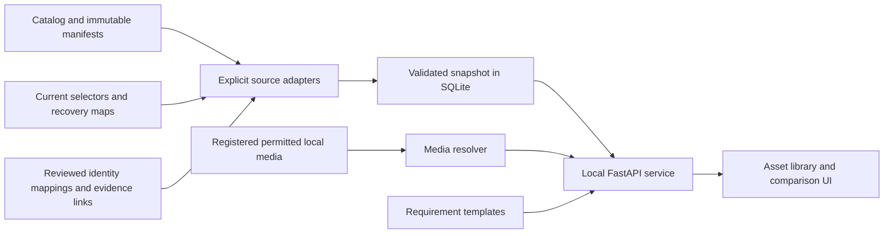

# Paris Street Combat Asset Workbench Technical Design

Implementation note (2026-10-11): [V1 delivery, verification and limitations](IMPLEMENTATION_RESULT_20261011.md). The original design snapshot follows.

Date: 11 October 2026. Revision: 1.0. Status: implementation design, software not yet built.

[中文审阅版](TECHNICAL_DESIGN_20261011_ZH.md) · [Functional specification](FUNCTIONAL_SPEC_20261011.md)

## 1 Implementation contract

Implement FR01–FR10 and validate AC01–AC12 from the functional specification. The first release is a Windows localhost web application. It reads registered project metadata and permitted evidence, creates only its own index/cache/job records, and provides copyable new-asset requirement templates. Existing asset manifests, current selectors and original evidence retain their authority.

The five semantic pilots are German soldier/rig, Allied soldier/rig, first-person arms/weapon assembly, pressure-mine prop and recorded audio. Index every active Catalog group at group/file level, but do not claim every city mesh has already been curated into a logical asset.

No implementation commands below have been executed for this documentation task. Proposed directories, schemas, APIs and launchers are to be created during implementation. No changes to gameplay source, models, fingerprints, user saves, engine sessions, storage permissions or publication selections are required.

## 2 Stack and operating model

| Layer | Decision | Reason |
| --- | --- | --- |
| UI | React with TypeScript, Vite build, plain CSS | Search/filter pages, typed contracts and a small self-contained local bundle |
| API | Python 3.13, FastAPI, Pydantic 2, Uvicorn | Reuse the project's Python tooling and validate request/response boundaries |
| Index | Python sqlite3, one local SQLite database | Rebuildable relational index without a separate database service |
| Jobs | One in-process queue, one index writer | Serialize refresh and bounded verification; no Redis/Celery/service cluster |
| Media | Registered local image/audio endpoints | Existing evidence is sufficient for V1; no asset conversion on page load |
| Later 3D | Three.js GLTFLoader for reviewed GLB derivatives | Optional isolated preview with explicit provenance |
| Tests | pytest for ingestion/contracts, Playwright for UI flows | Test selection correctness and evidence scope, not just components rendering |

Observed on this host on 11 October: Python 3.13.7, Node v24.19.0, Python sqlite3 runtime 3.50.4. This is environment discovery, not a dependency compatibility test. Resolve the Node package-manager executable explicitly; pin actual package versions and lock files after an isolated install/build smoke test. Do not depend on an unpinned latest install or change global runtimes. Vite's current guide specifies Node requirements that the observed Node version exceeds; recheck against the version selected for installation. [Vite setup](https://vite.dev/guide/)

Serve the built frontend and API from one loopback origin, proposed default `http://127.0.0.1:8765`. Port and workspace root belong to ignored local configuration. Use one Uvicorn worker; a second instance must report the occupied port/instance lock and leave the existing process alone. There is no Windows service or automatic boot startup in V1.

Use SQLite rollback-journal mode (`DELETE`), foreign keys, `busy_timeout=5000` and short transactions initially. Current SQLite documentation describes WAL concurrency, its same-host requirement and a WAL-reset fix; the discovered 3.50.4 runtime is not a basis for enabling WAL. A later switch requires a patched runtime and measured benefit. Do not place the database on SFTP, a network share or inside Unreal Content. [SQLite journal modes and WAL constraints](https://sqlite.org/wal.html)

## 3 Architecture and write boundaries



Only the derived index, service logs, job receipts and regenerable preview cache are writable in V1. The server has no operation that writes back to a current selector, asset manifest, Unreal asset or original evidence. The registry mapping records introduced below are reviewed source inputs created through normal repository work, not edited implicitly by the browser.

V1 requires no remote connection. Remote availability displays existing dated verification records, not a new claim that SFTP is online. Existing download/restore scripts remain separate operations and are not exposed as browser actions.

## 4 Source authorities and adapters

| Adapter | Source | Accepted authority and handling |
| --- | --- | --- |
| Catalog | `Assets/Sync/CATALOG.json` | Active asset groups and pinned manifest SHA-256; verify raw manifest bytes before ingest |
| Asset manifest | Exact paths selected by Catalog | File inventory, expected sizes/hashes, declared storage and release verification; preserve extension fields |
| Local selection | `Docs/Development/CURRENT_DEVELOPMENT_BASELINE.json` | Current local gameplay/source selection only; retain embedded historical selectors as history |
| Review selection | Explicit registered `CURRENT_UI_REVIEW.json`, `CURRENT_EQUIPMENT_REVIEW.json` and later reviewed streams | One candidate per stream; do not choose the highest version across streams |
| Source snapshot | Selector-referenced `SOURCE_MANIFEST.json` | Exact source-file inventory; its paths are relative to the specified Project root, not repository root |
| Build distribution | Catalog-selected packaged-playtest manifest | Published download identity; never overwritten by a local candidate |
| Recovery | Exact referenced recovery maps | Original path/hash to retained file or archive member; read metadata without extracting archives |
| Evidence | Selector-listed results and curated document/image references | Scoped claims; parse supported result schemas, preserve unknown formats as unclassified evidence |
| Human mapping | New reviewed `Assets/Registry/` records | Stable logical identities, aliases and explicit usage/evidence mappings; no competing release selection |
| Historical prose/CSV | Registered asset catalogs, usage docs and failure analyses | Dated supporting evidence; cannot override a structured selector automatically |

Some existing `dependencies` arrays contain asset IDs without versions. Resolve them through the same captured Catalog snapshot and store `resolution_basis=catalog_at_snapshot`. Do not rewrite the historical manifest or imply it originally pinned that version. Missing IDs remain unresolved. Two different hashes claiming the same restore path within one selected closure block that closure; identical bytes can have several recorded owners.

Authoritative precedence is field-specific. Catalog controls shared asset releases; the development selector controls local gameplay; each review selector controls its candidate stream. Dated usage documentation may describe first adoption rather than the current release. Conflicts within one authority become issues rather than a silent newest-file-wins merge.

Keep raw metadata bytes/hash and an adapter version in each source record. Unknown required schema versions are unsupported; unknown optional fields are retained but do not pass checks. Never evaluate Python, JavaScript, PowerShell, Blender scripts or Markdown HTML while importing metadata.

## 5 Proposed source layout and storage

```text
Tools/AssetWorkbench/
  README.md
  pyproject.toml
  requirements.lock
  app/
    main.py                 # FastAPI entry and lifespan
    api/                    # typed read and derived-index routes
    adapters/               # explicit existing-schema readers
    domain/                 # identities, claims and selection resolution
    index/                  # SQLite schema, migrations and snapshots
    media/                  # registered-ID resolver and audience checks
    jobs/                   # one writer queue and job receipts
  frontend/                 # package.json, package-lock.json, src
  tests/                    # synthetic fixtures and contract tests
  run.ps1                   # proposed localhost entry
Assets/Registry/
  registry.json             # schema version and explicitly registered input paths
  assets/                   # public-safe logical identity records
  mappings/                 # reviewed bundle, revision and usage relationships
  templates/                # versioned requirement templates
Assets/LocalWorking/AssetWorkbench/
  config.local.json         # workspace roots and permitted private sources
  private-records/          # private audience/receipt/evidence mappings
  cache/                    # SQLite index and derived thumbnails
  runs/                     # non-secret local diagnostics and job receipts
  drafts/                   # future V1.1 task records, absent from V1 workflow
  runtime/                  # isolated Python environment and build outputs
```

All paths above are proposed. Reuse the existing ignored `Assets/LocalWorking/` boundary. During implementation verify new dependency/build-cache ignore rules before installation; do not blanket-unignore media or force-add files. Public registry records may contain public-safe source/rights references, never purchase receipts, credentials or private correspondence. Private mappings are excluded from source-clone exports.

A preview is a regenerable derived artifact, not a second editable asset tree. V1 serves already registered safe images directly where possible; any thumbnail is keyed by source SHA-256, transform parameters and generator version. Never copy complete asset bundles just to populate cards.

## 6 Normalized data model

All imported content tables are scoped by `snapshot_id`. References below use stable IDs plus exact revision identities, not mutable display names.

| Entity | Essential fields and constraints |
| --- | --- |
| `SourceRecord` | ID, registered path, source kind, raw SHA-256, schema/adapter version, observed time, size and health |
| `Snapshot` | ID, source-set digest, Git HEAD if available, dirty-source fingerprints, status, created time and issue summary |
| `BundleRevision` | Original asset ID/version, manifest hash, source record, provenance/rights references |
| `LogicalAsset` | Stable ID, bilingual name, category, origin route, owner and aliases; curated, not one per file |
| `AssetRevision` | Stable asset ID, revision ID, parent IDs, exact file-set digest, change summary and provenance |
| `RevisionFile` | Revision ID, relative path, expected SHA-256/size, storage reference, optional UE object path and role |
| `IntegrationRevision` | ID, source-manifest identity, optional Game hash, exact asset revision bindings and configuration references |
| `BuildSelection` | Channel/stream, selector hash, integration/source identity, Game identity, observed date; selection is derived |
| `UsageEdge` | From/to exact IDs, relation, source reference, basis and completeness; typed edges distinguish dependency from runtime observation |
| `EvidenceRecord` | ID, subject set, scope, run ID/mode, raw result hash, image IDs, environment, result, review reference and inheritance basis |
| `Claim` | Subject, dimension, value, scope, source record/pointer, effective date, evidence ID and optional superseded claim ID |
| `FileAvailability` | Expected file identity, resolved location, state, verification method/time, observed hash if actually calculated |
| `RequirementTemplate` | ID/version/category, required fields, units, budget rules, source-first constraints, early gate and stop fields |
| `Issue` | Stable code, severity, subject/source, explanation and permitted next action |

Bundle-to-asset and asset-to-integration relations are many-to-many. A renderer correction can change the integration identity with no change to the asset revision. `Blob` identities may deduplicate byte counts by SHA-256 plus size, but ownership, paths and license context remain separate. Expected-byte deduplication is labeled as manifest-based, not physical disk accounting.

Imported revision identity is deterministic: hash the namespace, original stable ID/version and raw manifest hash. An editorial logical asset ID survives renames through explicit aliases. A normalized file-set digest hashes a versioned canonical list of path/size/SHA tuples; it is distinct from the raw manifest hash. Retain both. Timestamps use ISO 8601 with offsets and display in America/New_York by default.

For legacy records without a full subject hash, store `identity_strength=label_only` or `partial` and the source reference. Preserve the historical assertion, but do not attach its pass to a current exact-hash revision until a reviewed mapping proves the relationship.

The following proposed mapping illustrates the distinction between identity and evidence; it is not a registered production record:

```json
{
  "schema_version": 1,
  "asset_id": "prop-pressure-mine",
  "names": {"en": "Pressure mine prop", "zh": "盘形地雷道具"},
  "category": "prop",
  "origin_route": "team_created",
  "revision_resolution": {
    "kind": "registered_model_review",
    "source_ref": "pressure-mine-model-review"
  },
  "usage_sources": ["equipment-review-selector", "ui-review-selector"],
  "selection_policy": "derive_from_authoritative_selectors"
}
```

Source IDs must first resolve through `registry.json` or private local registration. The actual private model-review schema must be inspected before writing its adapter; never invent missing hashes from the example.

## 7 Refresh and integrity algorithm

1. Acquire the application writer lock. Load only explicitly registered small configuration/source files. Assign a unique job ID and keep the currently active snapshot available.
2. Capture Catalog, selectors and mappings as raw bytes. Validate schemas, path syntax and size limits, then record SHA-256. Read only their declared dependencies and evidence references.
3. Verify each selected manifest's raw hash against Catalog, and each source manifest against its selector where pinned. A mismatch is critical. Historical prose can still be listed as conflicting evidence but cannot repair the mismatch.
4. Normalize in staging, resolve IDs and dependency closures within the captured source set, and generate issues for incomplete evidence, unavailable private files and unsupported optional metadata.
5. Re-read the authority files and compare hashes before activation. If they changed, discard the staged candidate and retry once; repeated drift leaves the old snapshot active with `SOURCE_CHANGED_DURING_SCAN`.
6. Insert staged rows in bounded transactions under a new snapshot ID. After constraints and closure checks pass, atomically change the active-snapshot pointer in a short transaction. Never expose half-populated rows as the current snapshot.
7. Record source-set digest, counts, timings and issues. Mark interrupted jobs incomplete on restart. Leave source files and earlier evidence untouched.

Every paginated or multi-request UI view pins one snapshot ID; cursors include it. If sources change immediately after activation, the display remains an honest dated snapshot and the next refresh marks the change. A workspace without Git can still index with `git_head=null`; dirty registered sources are identified by their actual hashes, not falsely represented by HEAD alone.

Critical authority corruption blocks activation; missing optional images merely degrades availability. On first launch with no valid snapshot, show an actionable empty/error state, not fixture data. No automatic full Content traversal: metadata scans do not hash the city, compiled caches or junction targets.

On-demand local byte verification operates on a registered asset/file set only, reads streams without writes, and records bytes checked and coverage. Default proposed limit is 1 GiB per job; an oversized request returns an estimate and remains unstarted until a specifically increased bound is requested. Size/mtime are a cache hint, never proof of exact content. A failed verification cannot be presented as a successful remote publication check.

## 8 Status and evidence normalization

Map only known result schemas. A pass requires an explicit successful result, correct subject identity, required result fields and the declared scope's completion criteria. Exit code zero alone is insufficient. Store `fixture_error`, `incomplete`, `fail`, `unassessed` and `inherited` distinctly.

Image evidence includes source SHA, subject revision/build, capture context, whether actual pixels were reviewed, and comparison-camera information when available. A screenshot request or filename supplies none of these guarantees by itself. Inherited evidence records both the original tested Game and the current subject, with exact unchanged-scope justification; the UI never labels it as a fresh run.

Human adoption with known limitations is a separate claim from a technical failure. Corrective annotations append a claim pointing to the old result; they never rewrite its JSON or rename its failed images. Recovery-map availability is `recoverable`, not `local`, until the retained file/member is independently verified.

## 9 HTTP API and error contract

Prefix: `/api/v1`. JSON read responses include `snapshot_id`, source/issue references and generated time. List limit defaults to 50 and caps at 200. Cursors pin snapshot and sort keys; validate sort/filter names against explicit enums. Response models exclude private local configuration and hidden fields. [FastAPI response validation and filtering](https://fastapi.tiangolo.com/tutorial/response-model/)

| Method and route | Contract |
| --- | --- |
| `GET /health` | Service/index version and current job status; no filesystem paths or credentials |
| `GET /overview` | Independent channels, group/asset/file counts and health issues |
| `GET /assets` | `q`, category, origin, lifecycle, rights, availability, usage, cursor and limit |
| `GET /assets/{id}` | Asset facts, source pointers, revision summaries and limitations |
| `GET /assets/{id}/revisions` | Branch relationships and exact identities |
| `GET /comparisons?left=...&right=...` | Two revision IDs from one pinned snapshot; file/metric/evidence differences |
| `GET /builds` and `GET /builds/{id}/usage` | Selection scope and typed dependency/use graph |
| `GET /evidence/{id}` | Scoped result, original-subject identity and permitted media references |
| `GET /media/{id}` | Registered media only; MIME, audience, integrity and range limits enforced |
| `GET /sources/{id}/excerpt` | Registered textual excerpt, safely rendered; no arbitrary path input |
| `GET /templates` and `GET /templates/{id}` | Versioned complete requirement text/schema for copying |
| `GET /issues` | Filterable issues with source and severity |
| `POST /index/jobs` | Start allowlisted `refresh_metadata` or bounded `verify_local` work; idempotency key required |
| `GET /index/jobs/{id}` | queued/running/succeeded/degraded/failed/cancelled and actual coverage |
| `POST /index/jobs/{id}/cancel` | Cooperatively cancel index work; no process termination of UE or external tools |

Errors use `code`, `message`, `subject_id`, `retryable` and optional permitted source references. Examples: `MANIFEST_HASH_MISMATCH`, `SOURCE_SCHEMA_UNSUPPORTED`, `PATH_NOT_REGISTERED`, `MEDIA_UNAVAILABLE`, `RIGHTS_NOT_ESTABLISHED`, `SOURCE_CHANGED_DURING_SCAN`, `SNAPSHOT_NOT_AVAILABLE` and `INDEX_BUSY`. Use 403 for denied media, 404 for unknown IDs, 409 for state conflicts, 422 for invalid requests and 503 when no valid index exists. Do not leak local paths in generic errors.

Search uses normalized Chinese/English aliases and literal substring matching for V1, with indexed categorical filters and parameterized SQL. Escape LIKE wildcards; do not claim Chinese word segmentation from SQLite's default tokenizer. Optimize only after measuring the specified fixture.

## 10 Local access and media resolution

Listen only on loopback and accept the configured Host/Origin. The launcher generates an ephemeral bootstrap token, passes it in the browser URL fragment, and the UI exchanges it at `POST /api/v1/session` for an HttpOnly SameSite=Strict session cookie. Clear the fragment immediately, never log tokens, and require same-origin plus a session CSRF token for job POSTs. This is local session isolation, not multi-user authentication. A restart expires sessions. Development CORS, if used, lists an exact loopback origin; production is same-origin.

Resolve media by registered ID and expected SHA, not user-provided file paths. Validate real Windows paths beneath configured allowed roots. Reject traversal, UNC/device paths, alternate data streams and unregistered reparse points. Existing junctions are allowed only through an explicit mapping with validated source and target roots; do not recursively follow links. Revalidate the opened file's final path and identity before serving to limit replacement races.

Allow only supported raster images and approved audio in V1, with MIME/signature agreement, image pixel limits and bounded range streaming. Proposed limits: 50 MiB per image, 100 megapixels decoded, 100 MiB per audio source; these are private-viewer resource limits, not Git allowlist limits. Oversized media keeps metadata with a clear unsupported-preview message. Raw HTML/SVG/script and unregistered documents are not served as active content. Render imported text as escaped text or sanitized Markdown without raw HTML.

Media whose expected hash no longer matches becomes `MEDIA_CHANGED` and is not presented as that revision's evidence. Cache exact verification by file identity only within a bounded session and invalidate on change; critical comparisons can reverify. Persisted verification always records its time and method rather than asserting perpetual validity.

Private purchase receipts and credentials are never browsable media. Rights decisions are audience/use-specific and backed by a record; filesystem readability is not sufficient. Public source-only mode lists metadata and placeholders. Later team deployment needs real user authentication, per-user audience checks and TLS before any non-loopback binding.

## 11 Frontend implementation details

Routes: `/`, `/assets`, `/assets/:id`, `/compare`, `/builds`, `/builds/:id`, `/requirements` and `/health-check`. Keep the UI Chinese by default, retaining English technical names and bilingual search aliases. Model status labels from explicit enums; never map unknown values to a green fallback.

Store query/filter/sort/selected revisions in the URL for repeatable navigation. A snapshot identifier pins comparisons. Use server pagination and lazy image loading, cancel obsolete requests, and show loading/empty/failed/inaccessible/stale states separately. Cards use fixed image aspect ratios to avoid layout shifts; full-resolution evidence opens on demand.

The usage graph starts as an expandable dependency tree/table with reverse lookup, which stays readable with many packages. Add an interactive graph only if it improves an actual task. Retired/rejected entries are filterable but stay accessible. Color is supplementary to text labels; visible focus and keyboard activation are required.

No fabricated previews, success counters or mock metrics in normal mode. Synthetic fixtures belong only to tests and a visibly labeled demo configuration that cannot open production media.

## 12 Requirement templates and future writes

V1 templates are versioned JSON plus a generated text presentation. Required groups match functional section 7. Fields declare type, unit, required/applicable conditions, allowed route, target/hard budget and validation scope. A complete template is copyable without saving a database row.

V1.1 can introduce `TaskDraft`, `ReviewDecision` and `MetadataProposal` as append-only/revisioned local source records under the ignored drafts/private-records trees. A draft records its template version and captured baseline hashes. Use optimistic concurrency (`If-Match` record hash), unique event IDs and same-directory temporary-file plus atomic replace for each record. Multi-file publication must use an explicit transaction/recovery journal; do not pretend independent file writes are atomic.

The database remains a projection of these source records. A browser review cannot directly set Catalog current, overwrite a game selector or upload bytes. A metadata proposal produces a concrete diff and impacted dependencies for the separately authorized integration workflow. Public-safe approved records can later be added through normal Git review; private drafts do not become public merely because they reference a public asset ID.

## 13 Optional UE and 3D adapters

V1 does not require an engine launch. V1.2 may export a read-only inventory using the matching selected Editor and a bounded package/path list. Wait for Asset Registry discovery to complete; record engine build, selected source, map scope and scan coverage. The registry provides metadata without needing to load every asset. A registry reference remains different from observed runtime binding. [UE Asset Registry](https://dev.epicgames.com/documentation/en-us/unreal-engine/asset-registry-in-unreal-engine)

Custom validators may use UE Data Validation for naming, budgets and dependencies. Treat validation requiring package loads separately from the inexpensive metadata scan, with a bounded output and process owner. Data Validation is extensible and needs project-specific rules; its existence does not imply those rules already pass. [UE Data Validation](https://dev.epicgames.com/documentation/en-us/unreal-engine/data-validation-in-unreal-engine)

Reuse authorized running Editors only when their source/binary identity matches. Preserve user sessions and unsaved work; never use this browser to resave native packages or repair assets automatically. The mine's transient runtime construction needs its own source/result adapter and later runtime evidence; absence from native Asset Registry is not absence from the game.

For optional GLB preview, use a separately reviewed artifact with source/export hashes. Block external URI fetches, set size/texture limits, dispose GPU resources and retain the original asset. Do not load `.uasset` or `.blend` directly in the browser, or execute embedded source scripts. Three.js provides GLTFLoader for glTF assets; implementing this preview does not reproduce UE shading or prove runtime behavior. [Three.js GLTFLoader](https://threejs.org/docs/pages/GLTFLoader.html)

## 14 Implementation sequence

| Step | Concrete work | Required exit evidence |
| --- | --- | --- |
| M0 | Freeze explicit read/write roots, inspect private pilot schemas, define reviewed aliases; record protected input fingerprints | Source authority table resolved; private unknowns remain explicit; no blanket directory scan |
| M1 | Create isolated environment, typed models, schema migrations, Catalog/selector adapters and snapshot CLI | Exact manifests accepted; wrong hash/schema and source drift rejected; no protected writes |
| M2 | Curate five families, add evidence/status mapping and read API | AC01, AC03–AC07, AC09, AC11 pass at API/index level before UI expansion |
| M3 | Implement pages, comparison, requirement copying and media resolver | AC02, AC08, AC10, AC12 plus complete FR01–FR10 behavior |
| M4 | Validate cold/restart/degraded modes, measured performance and real-data walkthrough; produce launcher and setup guide | Dated result with exact source identities, measured limits, screenshots and remaining issues |
| Later | V1.1 writes, V1.2 exporters/previews, team hosting | Separate scoped implementation and validation for each stage |

Proposed development entry points, created in M1–M4, are `python -m app.cli index --metadata-only`, `python -m pytest`, the frontend's `npm ci`/`npm run build`/UI test commands, and `Tools/AssetWorkbench/run.ps1`. Run them in the isolated environment and documented working directory; do not advertise these commands as available before their files exist. The production launcher only starts the local web service and browser, never UE or an asset restore.

## 15 Verification matrix and stop rules

Use small synthetic manifests for negative contracts and read-only actual selectors for the pilot. Failed fixture output stays a fixture result; it cannot become a claim about asset compatibility.

| Test | Scope and expected assertion |
| --- | --- |
| T01 | Catalog hash mismatch and unknown required schema block activation; previous snapshot survives |
| T02 | Three selection channels retain separate exact identities; dirty source bytes are not represented by Git HEAD alone |
| T03 | Bundle/revision/binding many-to-many mapping preserves original model identity across integration-only changes |
| T04 | Hash duplicates reduce expected unique-byte counts only; path/rights ownership and revision history remain |
| T05 | Mine Blender success plus UE failure, German accepted limitations and inherited tests remain distinct |
| T06 | Missing private file, inaccessible path, retired recovery member and source-only clone have correct availability states |
| T07 | Exit0 without RESULT, unknown mode, wrong Game hash and mismatched screenshot are not passes |
| T08 | Concurrent source edits, cancellation and crash before pointer activation expose no partial snapshot |
| T09 | Media traversal, encoded traversal, junction escape, altered bytes, wrong MIME, unauthorized audience and oversized input are rejected |
| T10 | API limits, literal Chinese/English search, snapshot pagination, template completeness and unsupported write routes behave as specified |
| T11 | Browser workflows at both target sizes are keyboard-accessible and visually inspected; acquisition of screenshots waits for rendering |
| T12 | At least 20,000 indexed file rows; record query p95, startup/first-page timing and media timing separately with machine configuration |
| T13 | Instrument writes and compare pre/post fingerprints for registered protected metadata and sampled served evidence; only owned cache/run files change |
| T14 | Rebuild after removing only a disposable test index reproduces semantic identities and source-set digest; source records remain intact |

Do not claim T13 audited every native file when it did not. Endpoint absence, write-root instrumentation and scoped fingerprints complement each other. Test teardown deletes only its own verified temporary directory; no production media, recovery archive or old failure cleanup is part of this project.

Cases read: [MI030](../../../Failures/MI030-20261011-mine-render-winding/ANALYSIS.md) requires separate actual UE evidence; [MI033](../../../Failures/MI033-20261011-ui-screenshot-timing/ANALYSIS.md) requires pixel/subject matching; [MI035](../../../Failures/MI035-20261011-ui-restore-fixture-alias/ANALYSIS.md) separates test identity from executable mode; [MI036](../../../Failures/MI036-20261011-ui-ready-selection-fixture/ANALYSIS.md) rejects exit-code-only success; [GP010](../../../Failures/GP010-20261004-german-rifle-native/FAILURE_ANALYSIS.md) separates configuration from effective runtime behavior. The [catalog intake implementation](../ASSET_CATALOG_AND_RELOAD_REVIEW_IMPLEMENTATION_20261003.md) supplies prior duplicate-detection and immutable-original lessons.

This attempt changes the mechanism by using explicit adapters, scoped claims and immutable index snapshots rather than inferring acceptance from filenames or folder presence. The early acceptance check is M2's three independent channels plus failed/missing/incomplete evidence. Stop on protected-file drift attributable to this tool, unregistered path traversal, authority ambiguity, private-media exposure, false acceptance, or a repeated failed import without a changed bounded correction. Preserve the failed job, keep the last good snapshot, and fix the adapter or contract before advancing.

## 16 Delivery and document maintenance

V1 delivery consists of the local source tool, reviewed mapping/template records, reproducible dependency locks, launcher/setup instructions and a dated acceptance result. Screenshots included in public documents must use the existing exact-path image allowlist and public review; private evidence stays private. A source commit, SFTP transfer or hosted deployment is not included in this documentation authorization.

FR01–FR10 map to sections 4–13; AC01–AC12 map to M1–M4 and T01–T14. The English and Chinese documents share revision 1.0 and the same IDs, limits and phase boundaries. Update both when implementation changes a contract, and record measurements only after actual execution.
