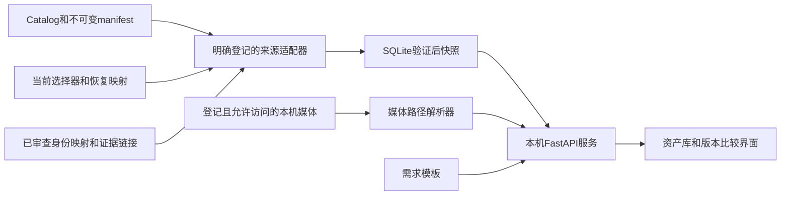

# 巴黎巷战资产工作台技术实施文档

实施记录（2026-10-11）：[V1实现、测试与限制](IMPLEMENTATION_RESULT_20261011_ZH.md)。下文保留原设计快照。

日期：2026年10月11日。修订：1.0。状态：实施设计，软件尚未构建。

[英文原稿](TECHNICAL_DESIGN_20261011.md) · [功能文档](FUNCTIONAL_SPEC_20261011_ZH.md)

## 1 实施合同

实现功能文档中的FR01–FR10，验证AC01–AC12。首版是在Windows本机localhost运行的网页应用，读取登记的项目元数据和允许访问的证据，只创建自身索引、缓存和任务记录，并提供可复制的新资产需求模板。已有资产manifest、当前选择器及原始证据继续保持权威。

五类语义试点为德军人物／骨架、盟军人物／骨架、第一人称手臂与枪械组合、地雷道具、录制音频。所有当前Catalog组都进入组／文件级索引，但不声称城市内每个网格已经整理成逻辑资产。

本轮文档工作没有执行下文实施命令。所列目录、schema、API和启动脚本均将在实施阶段创建。不需要改变玩法源码、模型、指纹记录、用户存档、引擎会话、存储权限或发布选择。

## 2 技术栈与运行方式

| 层 | 选择 | 理由 |
| --- | --- | --- |
| 前端 | React、TypeScript、Vite构建、普通CSS | 实现搜索筛选与类型明确的页面，生成小型本机静态包 |
| API | Python 3.13、FastAPI、Pydantic 2、Uvicorn | 复用项目Python工具，并验证请求和响应边界 |
| 索引 | Python sqlite3和一个本机SQLite数据库 | 可重建的关系索引，无须额外数据库服务 |
| 后台任务 | 进程内单队列、单索引写入者 | 串行执行刷新和有界核验，不引入Redis／Celery／服务集群 |
| 媒体 | 登记后的本机图片和音频接口 | V1先使用已有证据，不在打开页面时转换资产 |
| 后续三维 | Three.js GLTFLoader读取审查后的GLB副本 | 可选的独立预览，保留明确来源 |
| 测试 | pytest验证导入和合同，Playwright验证页面流程 | 验证选择与证据范围，而不仅是组件能否显示 |

10月11日本机实际发现Python 3.13.7、Node v24.19.0、Python sqlite3运行库3.50.4。这是环境发现，不是依赖兼容性测试。实施时明确找到Node包管理器程序，通过独立安装与构建冒烟检查后锁定实际依赖及lock文件。不能依赖未固定的latest安装，也不更改全局运行时。当前Vite指南的Node最低要求低于本机已发现版本，安装时仍应对选定Vite版本复核。[Vite安装说明](https://vite.dev/guide/)

构建后的前端和API由同一个loopback来源提供，建议默认地址为`http://127.0.0.1:8765`。端口和工作区根目录写入被忽略的本机配置。Uvicorn只开一个worker；第二个实例遇到端口／实例锁占用时应提示并保留已有进程。V1不注册Windows服务或开机自启。

SQLite初期采用回滚日志模式`DELETE`、外键、`busy_timeout=5000`和短事务。当前SQLite文档说明了WAL并发、同机限制和WAL-reset修复；本机3.50.4不能作为直接启用WAL的依据。后续切换需使用已修补的运行库并证明有实际收益。数据库不能放在SFTP、网络共享或Unreal Content内。[SQLite日志模式及WAL限制](https://sqlite.org/wal.html)

## 3 架构与写入边界



V1只允许写派生索引、服务日志、任务收据和可重建预览缓存。服务没有写回当前选择器、资产manifest、Unreal资产或原始证据的操作。下文新增映射记录属于通过常规仓库工作整理的输入，浏览器不能隐式改写。

V1不需要远程连接。远端可用性展示已有的带日期核验记录，不形成“SFTP现在在线”的新结论。已有下载和恢复脚本继续独立运行，不映射为浏览器按钮。

## 4 数据权威与适配器

| 适配器 | 来源 | 接受的权威范围和处理方式 |
| --- | --- | --- |
| Catalog | `Assets/Sync/CATALOG.json` | 当前资产组和manifest的固定SHA-256；导入前核对manifest原始字节 |
| 资产manifest | Catalog选择的精确路径 | 文件清单、期望大小／哈希、声明的存储及发布核验；保留扩展字段 |
| 本地选择 | `Docs/Development/CURRENT_DEVELOPMENT_BASELINE.json` | 只决定当前本地玩法／源码选择；内嵌旧选择器归入历史 |
| 候选选择 | 明确登记的`CURRENT_UI_REVIEW.json`、`CURRENT_EQUIPMENT_REVIEW.json`及后续审查过的候选流 | 每个流有自己的候选，不能跨流选编号最大者 |
| 源码快照 | 选择器引用的`SOURCE_MANIFEST.json` | 精确源码文件清单，其路径相对指定Project根目录，而非仓库根 |
| 构建发布 | Catalog选择的试玩包manifest | 已发布下载身份，不能被本地候选覆盖 |
| 恢复 | 精确引用的恢复映射 | 原路径／哈希到保留文件或压缩包成员；只读元数据，不展开归档 |
| 验收证据 | 选择器列出的结果及整理后的文档／图片引用 | 有范围的结论；解析已支持结果schema，未知格式保留为未分类证据 |
| 人工映射 | 新的`Assets/Registry/`审查记录 | 稳定逻辑身份、别名、明确的使用及证据关系；不形成第二套发布选择 |
| 历史文字／CSV | 登记的资产清单、使用说明和失败分析 | 带日期的辅助证据，不能自动覆盖结构化选择器 |

部分现有`dependencies`数组只有资产ID而没有版本。必须在同一次捕获的Catalog快照内解析，记为`resolution_basis=catalog_at_snapshot`。不能改写旧manifest，或声称原记录已固定该版本。找不到ID时保持未解析。同一选定依赖集合内，两个不同哈希占用相同恢复路径时阻止该集合通过；相同字节可以保留多个归属记录。

优先级按字段划分：Catalog控制共享资产发布，本地开发选择器控制本地玩法，每个评审选择器控制自己的候选流。带日期使用说明可能描述最初采用版本，而非当前发布版。同一权威内部冲突应形成问题，不能静默采用“最后修改的文件”。

每个来源记录保留原始元数据字节／哈希和适配器版本。未知的必需schema版本列为不支持；未知可选字段保留，但不能作为通过依据。导入时不执行Python、JavaScript、PowerShell、Blender脚本或Markdown中的HTML。

## 5 建议源码目录与存储

```text
Tools/AssetWorkbench/
  README.md
  pyproject.toml
  requirements.lock
  app/
    main.py                 # FastAPI入口和生命周期
    api/                    # 类型明确的只读与派生索引接口
    adapters/               # 现有schema的显式读取器
    domain/                 # 身份、结论、选择解析
    index/                  # SQLite结构、迁移和快照
    media/                  # 登记ID解析和受众检查
    jobs/                   # 单写入队列和任务收据
  frontend/                 # package.json、package-lock.json、src
  tests/                    # 合成夹具和合同测试
  run.ps1                   # 拟建localhost入口
Assets/Registry/
  registry.json             # schema版本和明确登记的输入路径
  assets/                   # 可公开的逻辑身份记录
  mappings/                 # 已审查交付包、修订、使用关系
  templates/                # 版本化需求模板
Assets/LocalWorking/AssetWorkbench/
  config.local.json         # 工作区根和允许读取的私有来源
  private-records/          # 私有受众、凭证引用、证据映射
  cache/                    # SQLite索引和派生缩略图
  runs/                     # 无秘密的本机诊断和任务收据
  drafts/                   # 后续V1.1任务记录，V1流程不使用
  runtime/                  # 独立Python环境和构建产物
```

以上路径均为拟建。复用现有`Assets/LocalWorking/`忽略边界，实施时在安装依赖前核验新增依赖／构建缓存忽略规则，不能整体放开媒体或force-add文件。公开registry只能存可公开的来源／许可引用，不能存采购凭证、密钥或私有通信。仅源码克隆导出不包含私有映射。

预览是可重建的派生产物，不是第二份可编辑资产工作树。V1尽量直接服务已登记的安全图片；需要缩略图时，以源SHA-256、转换参数和生成器版本组成缓存键。不能为了卡片复制整个资产包。

## 6 规范化数据模型

所有导入内容表均以`snapshot_id`限定范围。下文关系使用稳定ID和精确修订身份，不使用会变化的显示名称。

| 实体 | 核心字段与约束 |
| --- | --- |
| `SourceRecord` | ID、登记路径、来源类别、原始SHA-256、schema／适配器版本、观察时间、大小、健康状态 |
| `Snapshot` | ID、来源集合摘要、可用时的Git HEAD、未提交来源指纹、状态、创建时间、问题摘要 |
| `BundleRevision` | 原资产ID／版本、manifest哈希、来源记录、来源／许可引用 |
| `LogicalAsset` | 稳定ID、中英文名、类别、来源路线、负责人、别名；人工整理，不是每个文件一条 |
| `AssetRevision` | 稳定资产ID、修订ID、父修订ID、精确文件集合摘要、修改说明、来源 |
| `RevisionFile` | 修订ID、相对路径、期望SHA-256／大小、存储引用、可选UE对象路径、角色 |
| `IntegrationRevision` | ID、源码manifest身份、可选Game哈希、精确资产修订绑定、配置引用 |
| `BuildSelection` | 用途／候选流、选择器哈希、整合／源码身份、Game身份、观察日期；选定状态从来源推导 |
| `UsageEdge` | 精确起止ID、关系、来源引用、依据、完整性；依赖与运行观察使用不同边类型 |
| `EvidenceRecord` | ID、对象集合、范围、运行ID／模式、原结果哈希、图片ID、环境、结果、评审引用、继承依据 |
| `Claim` | 对象、维度、值、范围、来源记录／字段位置、生效日期、证据ID、可选被替代结论ID |
| `FileAvailability` | 期望文件身份、解析位置、状态、核验方式／时间、实际计算后才有的观察哈希 |
| `RequirementTemplate` | ID／版本／类别、必填字段、单位、预算规则、现有资产优先约束、早期门槛、停止字段 |
| `Issue` | 稳定错误码、严重程度、对象／来源、解释、允许的下一步 |

交付包与资产、资产与整合都是多对多关系。渲染转换纠正可以只改变整合身份，资产修订不变。可按SHA-256加大小建立`Blob`身份以去重字节统计，但归属、路径和许可上下文仍分别保留。只根据期望字节的去重统计必须标记为manifest估算，不能当作实际磁盘占用。

导入修订身份采用确定性算法：对命名空间、原稳定ID／版本、原始manifest哈希求摘要。人工逻辑资产ID通过显式别名保留更名历史。规范化文件集合摘要基于带算法版本的路径／大小／SHA排序列表计算，与原始manifest哈希不同，两者均保留。时间使用带时区偏移的ISO 8601，默认按America/New_York显示。

旧记录没有完整对象哈希时，记为`identity_strength=label_only`或`partial`并附来源。保留其历史结论，但在审查映射证明关联前，不能把该通过状态贴到当前精确哈希修订。

以下拟议映射示例说明身份与证据的区别，不是已经登记的生产记录：

```json
{
  "schema_version": 1,
  "asset_id": "prop-pressure-mine",
  "names": {"en": "Pressure mine prop", "zh": "盘形地雷道具"},
  "category": "prop",
  "origin_route": "team_created",
  "revision_resolution": {
    "kind": "registered_model_review",
    "source_ref": "pressure-mine-model-review"
  },
  "usage_sources": ["equipment-review-selector", "ui-review-selector"],
  "selection_policy": "derive_from_authoritative_selectors"
}
```

来源ID必须先通过`registry.json`或私有本机登记解析。编写模型审查适配器前应实际查看私有文件schema，不能根据例子虚构缺失哈希。

## 7 刷新与完整性算法

1. 取得应用写入锁，只加载明确登记的小型配置／来源文件。分配唯一任务ID，保持当前有效快照可读。
2. 按原始字节捕获Catalog、选择器、映射。验证schema、路径语法和大小上限，记录SHA-256，只继续读取它们声明的依赖和证据。
3. 将选定manifest原始哈希与Catalog核对，将已固定的源码manifest与选择器核对。不匹配属于关键错误；历史文字可以作为冲突证据展示，不能用于修补不匹配。
4. 在暂存区规范化，在捕获的同一来源集合内解析身份与依赖，针对不完整证据、无法访问的私有文件及不支持的可选元数据生成问题。
5. 激活前重新读取权威文件并比对哈希。如有变化，丢弃暂存候选并最多重试一次；持续变化时保留旧快照，报告`SOURCE_CHANGED_DURING_SCAN`。
6. 以新的快照ID分批短事务写入暂存记录。约束及依赖检查通过后，在一个短事务内原子更新有效快照指针。不能将部分填充的数据作为当前快照暴露。
7. 记录来源集合摘要、数量、耗时和问题。重启时把中断任务标为不完整，不修改源文件或旧证据。

分页及需要多次请求的页面固定一个快照ID，游标也携带该ID。激活后立即发生源文件变化时，当前页面仍是有日期的真实快照，下次刷新再标记变化。无Git的工作区可以使用`git_head=null`；已登记但未提交的源码以实际哈希标识，不能仅用HEAD假装完全匹配。

关键权威数据损坏阻止激活，可选图片缺失只降低可用性。首次启动没有有效快照时显示明确的空／错误状态，不展示夹具数据。禁止自动遍历整个Content：元数据扫描不对城市、编译缓存或junction目标进行全量哈希。

按需本机字节核验只处理登记的资产／文件集合，只流式读取不写入，并记录检查字节数与覆盖范围。建议默认每任务1 GiB上限；超限请求返回估算，保持未启动，直到明确请求提高该次限额。大小和mtime仅作缓存线索，不能证明字节完全一致。失败核验不能被呈现为远端发布验证成功。

## 8 状态与证据规范化

只映射已知结果schema。判定通过需要显式成功结果、正确对象身份、必需结果字段及该范围规定的完成条件。退出码零不足以通过。`fixture_error`、`incomplete`、`fail`、`unassessed`、`inherited`分别保留。

图片证据包括源SHA、对象修订／构建、拍摄情境、是否实际复看像素，以及有记录时的比较相机信息。截图请求或文件名本身不能保证这些条件。继承证据同时记录原测试Game和当前对象，以及精确的未变范围依据；界面不能把它显示为当前版本新跑的测试。

带已知限制的人工采用与技术失败属于不同结论。纠正注释通过新结论链接旧结果，不能改写原JSON或重命名失败图片。恢复映射只能显示`recoverable`；实际保留文件／归档成员独立核验前，不能显示为`local`。

## 9 HTTP接口与错误合同

前缀为`/api/v1`。JSON读取响应附`snapshot_id`、来源／问题引用和生成时间。列表默认50条，上限200条。游标固定快照与排序键，排序和筛选名称须通过显式枚举验证。响应模型排除私有本机配置和隐藏字段。[FastAPI响应验证与过滤](https://fastapi.tiangolo.com/tutorial/response-model/)

| 方法与路径 | 合同 |
| --- | --- |
| `GET /health` | 服务／索引版本和当前任务状态，不返回文件系统路径或凭证 |
| `GET /overview` | 独立的选择用途、组／资产／文件数量、健康问题 |
| `GET /assets` | `q`、类别、来源、生命周期、许可、可用性、用途、游标、数量 |
| `GET /assets/{id}` | 资产事实、来源位置、修订摘要、限制 |
| `GET /assets/{id}/revisions` | 分支关系与精确身份 |
| `GET /comparisons?left=...&right=...` | 同一固定快照中的两个修订ID，返回文件／指标／证据差异 |
| `GET /builds`和`GET /builds/{id}/usage` | 选择范围及有类型的依赖／使用关系 |
| `GET /evidence/{id}` | 有范围的结果、原测试对象身份、允许的媒体引用 |
| `GET /media/{id}` | 仅登记媒体，执行MIME、受众、完整性及范围读取限制 |
| `GET /sources/{id}/excerpt` | 安全显示登记的文本摘录，不接受任意路径 |
| `GET /templates`和`GET /templates/{id}` | 可复制的完整版本化需求文本／schema |
| `GET /issues` | 按来源及严重程度筛选问题 |
| `POST /index/jobs` | 只启动允许的`refresh_metadata`或有界`verify_local`任务，必须有幂等键 |
| `GET /index/jobs/{id}` | queued／running／succeeded／degraded／failed／cancelled及实际覆盖范围 |
| `POST /index/jobs/{id}/cancel` | 协作取消索引任务，不终止UE或外部工具进程 |

错误包含`code`、`message`、`subject_id`、`retryable`及可选且允许的来源引用。例子为`MANIFEST_HASH_MISMATCH`、`SOURCE_SCHEMA_UNSUPPORTED`、`PATH_NOT_REGISTERED`、`MEDIA_UNAVAILABLE`、`RIGHTS_NOT_ESTABLISHED`、`SOURCE_CHANGED_DURING_SCAN`、`SNAPSHOT_NOT_AVAILABLE`、`INDEX_BUSY`。媒体拒绝使用403，未知ID用404，状态冲突用409，无效请求用422，没有有效索引用503。通用错误不泄露本机路径。

V1搜索采用规范化中英文别名和字面子串匹配，类别筛选建索引，SQL参数化。转义LIKE通配符，不能声称SQLite默认分词器支持中文分词。先测量规定夹具，再决定优化。

## 10 本机访问与媒体解析

只监听loopback，接受配置中的Host／Origin。启动器产生临时bootstrap token，通过浏览器URL fragment传入；前端在`POST /api/v1/session`交换为HttpOnly、SameSite=Strict的会话cookie。随后立即清除fragment，不记录token。后台任务POST同时要求同源和会话CSRF token。这是本机会话隔离，不是多人身份认证；重启后会话失效。开发阶段如使用CORS，也只登记精确loopback来源，正式本机运行保持同源。

媒体通过登记ID和期望SHA解析，不能由用户提交文件路径。真实Windows路径必须位于允许根目录内。拒绝路径穿越、UNC／设备路径、备用数据流、未登记reparse point。现有junction只有在源和目标根均验证的明确映射下允许，不递归跟随链接。打开文件后再次核对最终路径和身份，降低文件被替换的竞态风险。

V1只允许支持的光栅图片和获准音频，检查MIME与文件签名一致、图像像素上限、有界分段传输。建议限制为每图50 MiB、解码100 megapixels、每音频源100 MiB；这些是私有浏览器资源限制，不是Git白名单限制。超大媒体仍显示元数据，并明确说明不能预览。不以可执行内容形式服务原始HTML／SVG／脚本或未登记文档。导入文字用转义文本或不允许原始HTML的净化Markdown显示。

媒体实际字节不再匹配期望哈希时，标记`MEDIA_CHANGED`，不能继续作为该版本证据展示。仅在有界会话内按文件身份缓存精确核验，变化时失效；关键比较可重新核验。持久记录始终保留验证时间和方式，不宣称永远有效。

私有采购凭证和密钥永远不是可浏览媒体。许可决定按受众和用途限定，须有记录；操作系统能读到文件不代表可以展示。公开源码模式显示元数据和占位。后续团队部署必须在非loopback监听前加入真实身份认证、逐用户受众检查和TLS。

## 11 前端实现细节

页面路由为`/`、`/assets`、`/assets/:id`、`/compare`、`/builds`、`/builds/:id`、`/requirements`、`/health-check`。默认中文界面，保留英文技术名称和双语搜索别名。状态标签来自明确枚举，未知值不能兜底成绿色。

搜索词、筛选、排序和所选比较修订保存在URL，方便重复进入；比较固定快照ID。采用服务端分页、图片懒加载，取消过时请求，分别显示加载、空、失败、无权访问、过时状态。卡片图片固定宽高比，避免加载时跳动；原尺寸证据按需打开。

使用关系先做可展开依赖树／表格及反向查询，保证包较多时仍易读。只有确实帮助某项任务时再加交互图。退休和否决记录可筛选但始终可访问。颜色之外必须有文字标签，保留可见焦点和键盘操作。

正常模式不出现虚构预览、成功计数或模拟性能。合成数据仅用于测试和明显标识的演示配置，演示配置不能打开生产媒体。

## 12 需求模板与后续写入

V1模板为版本化JSON加生成的文字呈现，必填组与功能文档第7节一致。字段声明类型、单位、必填／适用条件、允许路线、目标／硬预算和验证范围。复制完整模板不需要在数据库保存一行任务。

V1.1可引入`TaskDraft`、`ReviewDecision`、`MetadataProposal`，作为忽略目录drafts／private-records下追加或修订的本机源记录。草稿保留模板版本和捕获的基线哈希。采用乐观并发控制`If-Match`记录哈希、唯一事件ID，同目录临时文件加原子替换完成单条记录写入。多文件发布必须有明确事务／恢复日志，不能把独立文件写入当作整体原子操作。

数据库继续是源记录的投影。浏览器评审不能直接设置Catalog current、覆盖游戏选择器或上传字节。元数据提案生成可审阅diff和受影响依赖，交给另行授权的整合流程。可公开的批准记录以后通过正常Git审查加入；私有草稿不会因为引用公开资产ID就自动公开。

## 13 可选UE和三维适配器

V1不要求启动引擎。V1.2可使用与选定源码匹配的Editor，按有界包／路径列表导出只读清单。等待Asset Registry发现完成，记录引擎构建、选定源码、地图范围和扫描覆盖。Registry可提供无需加载每个资产的元数据；扫描引用与实际运行绑定仍是两类依据。[UE Asset Registry](https://dev.epicgames.com/documentation/en-us/unreal-engine/asset-registry-in-unreal-engine)

自定义验证可以使用UE Data Validation检查命名、预算和依赖。需要加载包的验证与低成本元数据扫描分开，明确输出范围及进程归属。Data Validation可扩展，需要项目专门规则，工具存在不等于这些规则已经通过。[UE Data Validation](https://dev.epicgames.com/documentation/en-us/unreal-engine/data-validation-in-unreal-engine)

只在源码／二进制身份一致时复用已经授权开启的Editor，保护用户会话和未保存工作。浏览器不能自动重存原生包或修复资产。地雷是运行时临时构建，需要自己的源码／结果适配器及后续运行证据；原生Asset Registry里没有不能解释成游戏中没有。

可选GLB预览使用单独审查的产物，记录源／导出哈希，阻止外部URI请求，设置大小和贴图限制，释放GPU资源并保留原资产。不在浏览器直接读取`.uasset`或`.blend`，不执行内嵌源脚本。Three.js提供glTF的GLTFLoader；实现浏览预览不等于复现UE材质或证明运行行为。[Three.js GLTFLoader](https://threejs.org/docs/pages/GLTFLoader.html)

## 14 实施顺序

| 步骤 | 具体工作 | 必需退出证据 |
| --- | --- | --- |
| M0 | 固定明确读写根，查看私有试点schema，定义审查过的别名，记录保护输入指纹 | 来源权威关系明确，私有未知项如实保留，不全盘扫描 |
| M1 | 创建独立环境、类型模型、schema迁移、Catalog／选择器适配器、快照CLI | 接受精确manifest，拒绝错误哈希／schema及来源变化，不写保护对象 |
| M2 | 整理五类资产，增加证据／状态映射和只读API | 扩展界面前，AC01、AC03–AC07、AC09、AC11在API／索引层通过 |
| M3 | 实现页面、比较、复制需求和媒体解析 | AC02、AC08、AC10、AC12及FR01–FR10完整行为 |
| M4 | 验证冷启动／重启／降级、测量性能、真实数据走查，交付启动器和安装指南 | 带日期结果、精确源码身份、实际测量限制、截图、遗留问题 |
| 后续 | V1.1写入、V1.2导出／预览、团队托管 | 每阶段单独限定实施与验证 |

拟在M1–M4创建的开发入口包括`python -m app.cli index --metadata-only`、`python -m pytest`、前端`npm ci`／`npm run build`／UI测试命令，以及`Tools/AssetWorkbench/run.ps1`。在独立环境和文档规定的工作目录执行，文件创建前不能宣称这些命令已可用。正式启动器只启动本机网页服务和浏览器，不启动UE或资产恢复。

## 15 验证矩阵与停止规则

负向合同使用小型合成manifest，试点使用只读真实选择器。测试夹具失败只记录夹具结果，不能直接写成资产不兼容。

| 测试 | 范围和预期断言 |
| --- | --- |
| T01 | Catalog哈希不匹配、必需schema未知时阻止激活，旧快照继续有效 |
| T02 | 三种选择用途保留独立精确身份，未提交来源不能只用Git HEAD表示 |
| T03 | 交付包／修订／绑定多对多关系正确，只有整合变化时原模型身份保持 |
| T04 | 哈希重复只减少期望唯一字节计数，路径／许可归属和版本历史仍保留 |
| T05 | 地雷Blender成功与UE失败、德军带限制接受、继承测试分别展示 |
| T06 | 私有文件缺失、路径无权访问、退休恢复成员、仅源码克隆的可用性正确 |
| T07 | exit0无RESULT、未知模式、Game哈希错误、截图错位都不能通过 |
| T08 | 同时修改来源、取消任务、指针激活前崩溃不暴露部分快照 |
| T09 | 媒体路径穿越、编码穿越、junction越界、字节变化、MIME错误、受众未获准、超大输入被拒绝 |
| T10 | API限额、中英文文字搜索、固定快照分页、模板完整性和未支持写接口符合合同 |
| T11 | 两种目标分辨率下键盘可操作，真实图片复看，截图等待绘制完成 |
| T12 | 至少20000条文件索引，记录机器配置，分别测查询p95、启动／首屏、媒体耗时 |
| T13 | 记录写入行为，对比登记的保护元数据及抽样已服务证据前后指纹，只有自有缓存／运行记录变化 |
| T14 | 仅移除可丢弃测试索引后重建，语义身份和来源集合摘要一致，源记录保持 |

T13没有核验全部native文件时不能如此声称。接口缺失、写入根监测和有范围的指纹核对互相补充。测试清理只处理本任务已确认的临时目录，生产媒体、恢复归档和旧失败清理不属于该项目。

已读案例：[MI030](../../../Failures/MI030-20261011-mine-render-winding/ANALYSIS.md)要求独立真实UE证据；[MI033](../../../Failures/MI033-20261011-ui-screenshot-timing/ANALYSIS.md)要求像素与对象匹配；[MI035](../../../Failures/MI035-20261011-ui-restore-fixture-alias/ANALYSIS.md)区分用例身份和可执行模式；[MI036](../../../Failures/MI036-20261011-ui-ready-selection-fixture/ANALYSIS.md)禁止仅凭退出码判断成功；[GP010](../../../Failures/GP010-20261004-german-rifle-native/FAILURE_ANALYSIS.md)区分配置与实际运行行为。[资产清单实施记录](../ASSET_CATALOG_AND_RELOAD_REVIEW_IMPLEMENTATION_20261003.md)提供重复交付识别和不可变原件经验。

本次机制改变为显式适配器、有范围的结论、不可变索引快照，避免根据文件名或目录存在推断通过。早期验收为M2的三种独立选择用途及失败／缺失／不完整证据。若工具导致保护文件变化、未登记路径越界、权威不清、私有媒体泄露、误报通过，或没有改变有界修正方案却重复导入失败，应停止。保留失败任务和上一次有效快照，修正适配器或合同后继续。

## 16 交付与文档维护

V1交付本机源码工具、审查后的映射／模板、可复现依赖锁、启动／安装说明和带日期验收结果。公开文档配图必须使用现有精确路径图片白名单并通过公开审查；私有证据保持私有。源码提交、SFTP传输和托管部署不包含在本次文档授权中。

FR01–FR10对应第4–13节，AC01–AC12对应M1–M4和T01–T14。中英文共享修订1.0，以及相同编号、限额和阶段边界。实施改变合同时同步两版，实际执行之后才能写入测量结果。
