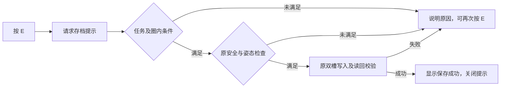

# 组员试玩反馈：菜单与 E 存档修复结果

2026-10-10。本批两项 P0 的本机原生 Game 回归通过，候选等待用户人工复验。
先按 [实施文档](G1_TEAM_FEEDBACK_IMPLEMENTATION_20261010_ZH.md) 形成方案，再修改。
依据为 [Jingdi 八项意见](../Proposal/Adjustment_Jingdi_20261010.md)。组员原测试
包未提供版本/EXE 哈希；本记录证明精确选定 audio V2 父版本上的修复，不能
据此断言组员 E 失败的唯一原因或另一台电脑已验证本候选。

## 修复的行为

Ready 与任务失败/错误状态显示可操作的 Begin/Restart、Load、Exit 菜单。
鼠标可以选择，Up/Down/Tab 切换焦点，Enter 执行；无兼容存档时 Load 明确
禁用。显示与命中区域共用比例/留边坐标，开始点击的按下/重复/释放被菜单
消费，进入后恢复正常游戏输入。

E 始终进入明确的存档请求/确认路径。在已解锁圈内关闭提示后，再按 E 即可
重试，无需离圈再回来；未清场、圈外、站立/移动/动作/小队事务条件及写盘
失败均给出原因。重复失败会刷新反馈时间，提示中持续显示当前阻挡条件。
原安全阈值、双槽 journal、校验和、写后读回保持；仅原存档函数成功后显示
`Mission saved (revision N)`。不会自动保存或为了成功而跳过小队安全检查。

## 本次实际验证

所有下列运行使用同一 candidate_v4 Game，均正常退出 0。诊断由显式命令行
启用，使用 UE 输入/原生导航/原枪械事务，独立 UserDir；普通试玩入口不启用。

| 运行 | 实际结果 |
|---|---|
| `menu_v2`，1920×1080 | 25 项通过：鼠标开始、禁用 Load 原因、箭头/Tab 焦点、菜单点击不射击、开始后实际移动 |
| `menu_720p_v1`，1280×720 | 同样 25 项通过，实际缩放画面与点击正常；另有四种宽高比的坐标命中检查 |
| `checkpoint_v1` | 28 项通过：旧 V5 Load 按钮、死亡终态、Esc 后 E 重试、走动/蹲伏说明、重复反馈、只读写盘负例及重试、F9/F6 |
| `restore_v1` | 19 项通过：独立新进程读取新写入 revision 2；六名角色资源、位置及三名德军死亡终态核对通过 |
| `route_v1` | 从新任务正常过桥、实际射击清除三名守军、提示/拒绝/离圈/重入、走动拒存、E 保存、F9、F6 均通过；865 个采样的 loaded+reserve+shots 始终为 18 |

旧 V5 journal 副本只用于兼容性测试；`route_v1` 的新任务清场与保存是独立
实测。写盘负例只把诊断目录下一槽的有效副本设为只读；失败后当前 serial
保持 1、原 A 槽字节未变；解除只读并按 E 后 B 槽成功写入 revision 2，并
由原 readback 校验通过。没有修改原用户目录或系统权限。

本机截图已逐张检查：1080p/720p 菜单、蹲伏拒存、保存成功。原始日志/截图/
结果是本地私有 QA 证据，路径见下；未作为公开素材、视频或课程验收替代品。
本轮不是物理 OS 鼠标人工试玩。Lost/Error 菜单、Exit、跳跃/换弹时按 E 和
存活 NPC 进行事务时的独立负例尚需人工复验；这些安全条件仍按原代码保留，
不把未覆盖的分支标成实测通过。本次不重做全动作/接触、性能或自然遭遇验收。

## 保留与失败归档

父 42 文件、原 Game、Catalog、1,754 条 native/角色/枪械/音频记录及原用户
目录 3 文件的哈希复核通过。候选 45 文件中 39 个父文件精确不变；仅修改
mission/controller/HUD 所在 cpp/header 与模块的显式测试初始化。新增交互
辅助和 opt-in probe。四个受保护源码区段精确不变：任务/导航推进、快照校验/
读槽、原保存事务、应用快照/死亡恢复/资源验证。原音效代码精确不变。
未改模型、骨架、权重、材质、手指、动作、枪械绑定/射击/换弹、资源或 AI。

[MI019](../../Failures/MI019-20261010-menu-checkpoint-interaction/FAILURE_ANALYSIS.md)
保留 v1 测试辅助 API 编译失败、v2 未运行的旧负例设置、v3 反射布局导致的
cooked 地图加载失败；各自源码/程序/日志身份保留。v4 仅移除新增计数的
UPROPERTY，让它作为普通运行时字段；父 UPROPERTY/UFUNCTION 声明精确相同。
未重烘焙或替换地图。旧失败入口已标记 DO_NOT_USE，不是交付候选。

## 交付身份与使用

- 普通入口：`tmp/Playtest-G1-Interaction-V4-20261010/PLAY_G1_REVISION.cmd`
- 独立存档：`%LOCALAPPDATA%/ParisStreetCombat/G1Interaction20261010`；前缀仍为 `ParisG1PlaytestV5`
- Game SHA256：`040a6fa1bbf33d94fa6e14ba6e2510cff240fa8fbdddcd9ed83420c29a3f2e68`
- 源码：`Unreal/Variants/G1TeamFeedback20261010/Project`，45 文件
- Manifest SHA256：`2132c6657433b284160421d04e7a2f3fb639bca0af8221f1869b8be3f68972d6`
- 匹配 authoring：`tmp/g1-team-feedback-20261010/candidate_v4/Project`；仅 Game Development Win64 已构建，不宣称 Editor 已构建
- 私有证据：`tmp/g1-team-feedback-20261010/checks`、`verification.json`、candidate_v1–v4 收据
- 测试/复核工具：`Tools/Integration/G1TeamFeedbackV1`

建议人工顺序：新启动鼠标/键盘开始；打完三名守军进圈，走动按 E 看原因，
停下按 E 看成功；Esc 后不离圈再次按 E；重开后菜单 Load；再测试任务失败
菜单和 Exit。试玩存档与原版独立，首次启动没有兼容存档时 Load 禁用正常。

父 audio V2 仍为用户选定开发基线。当前候选不会自动替换 SFTP、已有演示/
课程 PDF；本次没有 commit/push。其余六项反馈的独立实施门槛保留在方案中。
