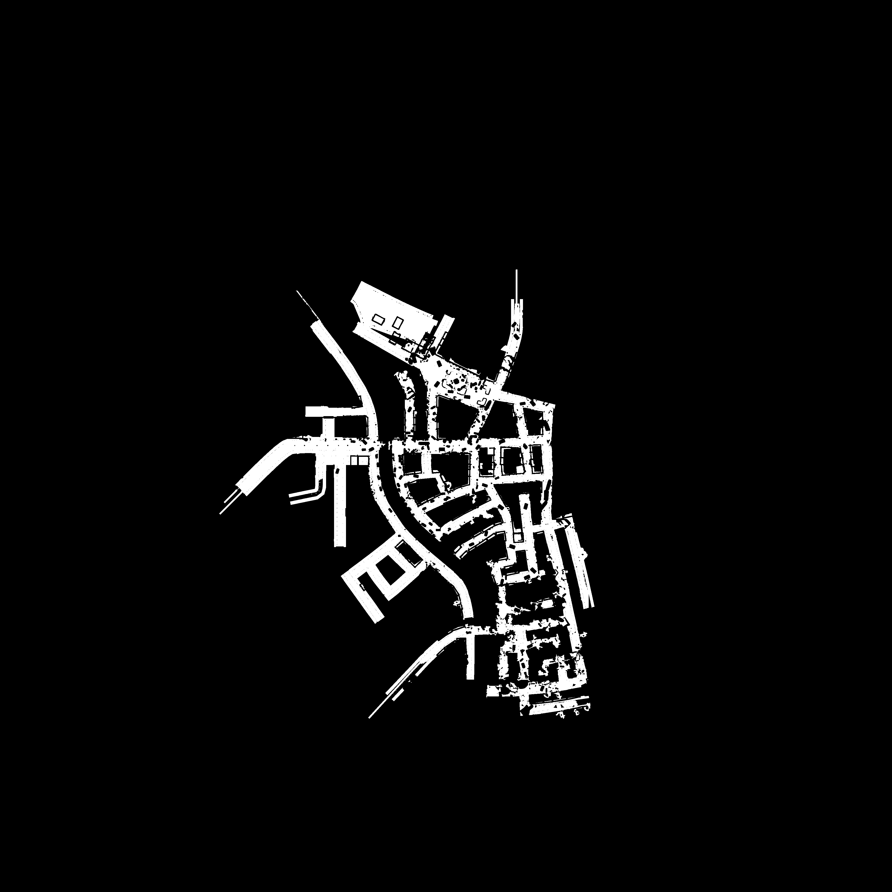
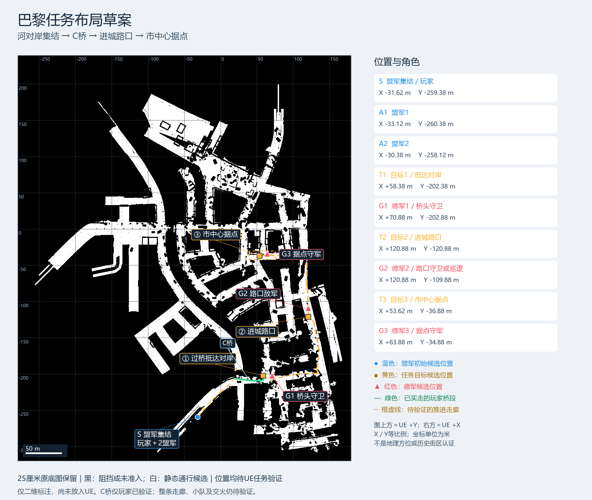

# 巴黎地图探索与玩法设计新窗口交接

**2026-10-18 当前入口更新：**直接使用[教学正式版启动脚本](../../Releases/Paris-Tutorial-1.0-20261017/PLAY_TUTORIAL.cmd)；根目录转发 CMD 已按用户要求删除，现有存档和正式包不变。版本以 [CURRENT_TUTORIAL_RELEASE.json](CURRENT_TUTORIAL_RELEASE.json) 为准，下文早期地图与玩法记录保留。[变更结果](MissionLoopV1/TUTORIAL_DIRECT_ENTRY_RESULT_20261018_ZH.md)。

13 October最新人工问题修正已完成：[匍匐鼠标／教学实施](MissionLoopV1/G1_PRONE_LOOK_IMPLEMENTATION_20261013_ZH.md)与[最终结果](MissionLoopV1/G1_PRONE_LOOK_RESULT_20261013_ZH.md)。源码85／build_look_v17，Game `63275254271c5d58a4d1f6bf9eb8d43a175e25b25f7f9bd7498d354fbb1f3ce3`，正常入口 `tmp/Playtest-G1-ProneLook-20261013/PLAY_PRONE_LOOK.cmd`。Z后鼠标左右转身体、上下观察；原身体盒／三点支撑按旋转区间中点及终点检查，墙边停止转入、反向可转回。WASD／斜向原60厘米/秒保持。任意原规则允许的平地趴稳开始计数，四方向各实际15厘米、总2.5米，显示缺项并自动进入Z起身和射击；旧85厘米起点／110厘米终点条件取消。5次同最终Game检查通过：鼠标／墙边／自动完成及完整CP0、四向斜向回归、720p完整基础流程、独立CP0恢复、未开新分支的旧P1。实际图已检查，动作复用原循环，非全图／自然战斗／精细接触验收。18份教程关联文档、新流程图、私有实际帧及四项玩法已本地平台刷新回读，见 `tmp/g1-tutorial-20261013/build_look_v17/SYNC_VERIFIED.json`。TU004保留人工v12拒绝、v13/v16诊断输入期限与v14旧提示问题。正式78／Catalog／1754原生文件保持，未结束用户进程；最后检查旧Game17452已不存在、Editor52532仍运行。等待人工重试，不自动采用／Git/SFTP发布／清理／作业上传。下方v12及之前的鼠标禁用、固定起终点说法均为历史状态。

13 October最新四向匍匐候选已完成：[实施](MissionLoopV1/G1_PRONE_STRAFE_IMPLEMENTATION_20261013_ZH.md)与[结果](MissionLoopV1/G1_PRONE_STRAFE_RESULT_20261013_ZH.md)。源码84／build_strafe_v12，Game `5fe928776e9a9607a98cac33575486b71a6b4021531e89737b8bf50a4d0610b8`；正常试玩入口 `tmp/Playtest-G1-ProneStrafe-20261013/PLAY_PRONE_STRAFE.cmd`。Z后W/S前后、A/D横移、组合键斜爬，保留原60厘米/秒与身体／支撑检查；原鼠标左右转向限制仍保留，横移暂复用原前后爬行循环，未制作新动作资产。四次同最终Game检查通过，覆盖实际方向输入、临时墙边阻挡和反向退出、完整基础教学CP0、独立进程读档与原P1回归；不扩写为全图／自然战斗／动作接触验收。14份关联教程文档、当前流程图、私有实测图片及新增`prone-movement`玩法已通过本地资产平台Refresh；收据 `tmp/g1-tutorial-20261013/build_strafe_v12/SYNC_VERIFIED.json`，索引229项／缺失引用0。等待人工试玩，正式78与Catalog不变，未Git/SFTP发布、清理或作业上传。以下v9的A/D禁用描述是历史状态，当前候选以上述v12为准。

13 October后续人工反馈：v8匍匐教学卡住。现已制作[匍匐指引修正版](MissionLoopV1/G1_TUTORIAL_CRAWL_RESULT_20261013_ZH.md)，源码83／build_crawl_v9，Game `7bc3fd68067eab4a864f78fdeeea21c7faa72446092de055cafeef890702a3c2`。原匍匐只支持W/S，禁止A/D与左右转向；新指引先到起点／趴下前对准箭头，再Z与W。保留实际2.5米／终点及碰撞支撑要求。3次新Game检查通过原控制限制／W/S位移、1080/720完整基础与CP0、真实恢复；原v8诊断曾在趴下时修改朝向，不是普通操控验收，见[TU002](../../Failures/TU002-20261013-prone-tutorial-guidance/ANALYSIS.md)。新入口 `tmp/Playtest-G1-Tutorial-Crawl-20261013/PLAY_TUTORIAL_CRAWL_FIX.cmd`，原用户Game和Editor保留；最新选择器及平台候选以v9为准，仍待人工重试。

13 October完整教程已完成本地统一候选，最新读[教程选择器](CURRENT_TUTORIAL_REVIEW.json)、[完整教学设计](MissionLoopV1/G1_COMPLETE_TUTORIAL_DESIGN_20261013_ZH.md)、[开发文档](MissionLoopV1/G1_TUTORIAL_DEVELOPMENT_20261013_ZH.md)及[实际结果](MissionLoopV1/G1_TUTORIAL_RESULT_20261013_ZH.md)。出生后移约23.5米，两名盟军改为(8.500，−214.750)／(9.000，−212.000)米，基础教学结束才开放对话招募。源码83／build_full_v8，Game `f10e9c8dcd2bb2c4f41d75cefcaefcc60aaeea8d625449ca32aaec7b84d104a1`；正常试玩 `tmp/Playtest-G1-Tutorial-20261013/PLAY_COMPLETE_TUTORIAL.cmd`，隔离UserDir／前缀，无诊断自动输入。

同一最终Game10次运行通过，包含真实基础动作／2.5米连续匍匐／投掷／三类补给／拆雷／两次招募、CP0／CP1写盘和新进程恢复、损坏新slot回退、旧模式回归。原玩家与两名已招募盟军实际过C到对岸；三守军清场检查用声明原伤害端点夹具，不是自然交火证明。CP0是用户要求的训练存档例外，CP1仍只按三守军全灭解锁。训练新点需运行时有界导航生成，保留原agent／默认预算及C危险排除；没有保存地图／原生导航。扩展小地图继续显示独立25厘米范围。

资产平台Refresh index与回读已成功：构建`tutorial-review`、玩法`g1-tutorial`／`allied-recruitment`／`tutorial-checkpoint`关联最终Game、6份中英文文档、新布局／流程图及私有实际截图，精确收据 `tmp/g1-tutorial-20261013/SYNC_VERIFIED.json`。最终正常交火、首次教学体验和人工采用等待用户复核；只有原两名G1招募人员，M2/M3与备用池未开发。正式78、1754原生文件、Catalog及显式保护的旧档保持；现有Editor不关闭。本轮未Git/SFTP发布、清理或作业上传。以下早期设计／76状态是有日期历史，以上最新记录优先。

12 October Git同步说明：用户随后授权按功能发布资产工作台和本交接资料，见
[本轮发布记录](GIT_FUNCTIONAL_PUBLICATION_20261012_ZH.md)。下文「平台尚未提交」
是交接编写时的历史快照；新窗口正在写的过桥探索实施／分析／绘图文件仍不在
本轮发布范围，不把源码同步当作新地点或玩法已经验收。

状态日期：2026年10月12日，美国东部时间。项目根目录：`D:\0.Rutgers\CS549\Project-New`。

新窗口继续研究现有巴黎地图如何支撑连续小队任务和战术选择。当前 G1 桥头任务、手雷、烟雾、地雷、有限弹药补给及战地手册已经整合并由用户人工接受逻辑；下一步重点是探索后续区域、验证路线与接敌条件，再设计有选择的战斗。保留现有模型、步枪手指姿态及已验证的枪械、资源与存档逻辑。

这是有日期的交接快照。后续明确的用户决定及经过核验的新记录优先；旧结果中的“待人工复验”“正式52”“audioV2仍是开发基线”等文字不能覆盖当前正式76版。

2026年10月12日本对话的新方向：用户要求把过桥至G1做成跑、跳、匍匐、装弹、有限补给和观察拆雷的教程，以主动存档结束，复杂玩法放在桥后。已完成[带图设计与路线探索结果](MissionLoopV1/PARIS_TUTORIAL_POSTBRIDGE_DESIGN_20261012_ZH.md)及[英文版](MissionLoopV1/PARIS_TUTORIAL_POSTBRIDGE_DESIGN_20261012.md)。两套25厘米保守测绘图的G1至T2连接仍有缺口；T2至T3已重建独立测绘连接，均不冒充新增实体实走。先核对待查连接、连续匍匐足迹和双向交火，再冻结实施；正式76、当前用户档与教师交付未改，教学完成不加入清场保存门槛。

## 接手时先读的文件

13 October最新完整教学方向见[完整教程设计](MissionLoopV1/G1_COMPLETE_TUTORIAL_DESIGN_20261013_ZH.md)：安全基础动作、射击换弹、手雷和烟雾、有限三类补给、拆雷、固定两人对话招募、CP0训练保存，再开放原三名守军，清场后CP1保存结束。CP0是本次用户新增训练阶段例外；战斗CP1仍只按所属敌组全灭解锁。已有[扩展小地图显示候选](MissionLoopV1/EXPANDED_MINIMAP_RESULT_20261013_ZH.md)，改贴图和UV范围，不改真实导航；正式78保持。旧可选第二人和清场后拆雷顺序不再作为当前教学方案。

13 October用户已选到[可匍匐候选N](MissionLoopV1/G1_PRONE_HUMAN_SITE_RESULT_20261013_ZH.md)：最后脚底厘米(91.186979，−22140.678907，99.250298)，原局部图A8。1891条位置记录中，附近有独立连续3.55米匍匐实移，最后再次趴下静止；不是最终点与爬行段终点同一位置的声明。先按此候选安排2～3米练习，接入前核对短廊和起身／NPC占位。原位置记录Game已结束，其他窗口翻越Game不动；独立试玩Esc释放鼠标，Alt+Tab切窗，位置记录版F2记点截图。

13 October最新[教学局部选点与盟军招募设计](MissionLoopV1/G1_TUTORIAL_SITE_AND_RECRUITMENT_DESIGN_20261013_ZH.md)：用户报告教学处不允许匍匐，已提供保存／扩展范围独立25厘米局部图，等待选择附近区域后验连续爬行。建议0/2起步，对话确认招募最多两名活盟军，阵亡空位由后续有限人员池补招；死亡ID、队员槽位和存档资源分别保留，招募不增加checkpoint门槛。人数、点位和实现仍为方案，原78版不改。

13 October用户最新分工：动作与建模由对应窗口负责，本“地图探索与玩法设计”窗口专注玩法、路线和教程。可直接转交[人物动作与建模交接清单](MissionLoopV1/TRAVERSAL_ACTION_MODEL_HANDOFF_20261013_ZH.md)：已有Rifle_Vault_1m／Rifle_Climb_1m及骨架兼容登记，首轮建议有限低障碍翻越；动作窗口回交统一候选与移动／镜头结果，建模窗口回交道具尺寸和接触结果。本窗口根据可用范围选教程和路线用途，不在这里继续动作／模型制作。

13 October后续[人工复核与越障建议](MissionLoopV1/AB_BRIDGE_HUMAN_REVIEW_AND_TRAVERSAL_DESIGN_20261013_ZH.md)：用户确认A对岸房屋／河道没有落脚连接，排除当前可玩跨岸路线；B能沿卡车旁红框通路走过，更新为玩家人工可通行。此前固定直线负面保持，不否定B旁路；AI／小队和返程仍待查。用户提出二段跳，当前建议为单跳＋低障碍翻越／攀上，尚未选择或实施。后续开发从已采用袖子78开始。

13 October实际桥梁检查：[A／B桥原玩家实走结果](MissionLoopV1/AB_BRIDGE_PHYSICAL_RESULT_20261013_ZH.md)。computer-use启动独立formal76诊断v3，四条固定普通步行腿均未达到另一岸；A正向桥缘停止、反向落空，B正向取得49个原桥支撑样本后停止、反向在瓦砾附近停止。不能扩写为全部入口／绕行／跳跃／小队永久不通，A/B仍不登记为采用通路。原C桥证据、正式76、用户档和袖子Editor保留；见BR001与实施方案，未改碰撞／预算、未发布或上传作业。

1. [项目规则](../../AGENTS.md)、[总交接](../../HANDOFF.md)、[失败案例索引](../../Failures/README.md)。
2. [当前正式选择器](CURRENT_DEVELOPMENT_BASELINE.json)、[正式采用结果](G1_GAMEPLAY_BASELINE_ADOPTION_RESULT_20261011_ZH.md)、[最新同步指南](TEAM_CURRENT_BUILD_20261011_ZH.md)。
3. [25厘米测绘](MissionLoopV1/FINE_GRID_RESULT_20261007_ZH.md)、[桥梁专项](MissionLoopV1/BRIDGE_CONNECTIVITY_RESULT_20261007_ZH.md)、[UE标准导航实走](MissionLoopV1/UE_STANDARD_NAV_RESULT_20261007_ZH.md)、[导航查询预算诊断](MissionLoopV1/UE_STANDARD_NAV_QUERY_RESULT_20261007_ZH.md)。
4. [连续小队路线草案](MissionLoopV1/CONTINUOUS_SQUAD_GAMEPLAY_DESIGN_20261010_ZH.md)、[战术装备玩法草案](MissionLoopV1/TACTICAL_EQUIPMENT_GAMEPLAY_DESIGN_20261010_ZH.md)。两份都是设计来源；其中旧基线、旧按键、待制作装备等状态以本次正式选择器和后续结果为准。
5. 查模型、地图来源、动画或特效时先读[资产索引](../../Assets/ASSET_INDEX.md)，按资产ID定向查询。索引无答案再搜索；不要递归扫全部 tmp、原始包或资产库。

## 当前正式版和发布身份

| 项目 | 当前值 |
| --- | --- |
| 正式源码 | `Unreal/Variants/G1GrenadeEquip20261011/Project`，精确76文件 |
| 活跃制作工程 | `tmp/g1-tactical-equipment-20261010/candidate_grenade_equip_v1/Project/WW2FranceLiberation.uproject`；历史名称v1内实际是最终build_v4，不能按文件夹名字删除 |
| 正常试玩 | `tmp/Playtest-G1-GrenadeEquip-20261011/PLAY_GRENADE_EQUIP.cmd` |
| 历史入口与当前入口 | 原根目录 `PLAY_CURRENT_G1.cmd` 已于 2026-10-18 撤下；当前使用[正式版启动脚本](../../Releases/Paris-Tutorial-1.0-20261017/PLAY_TUTORIAL.cmd) |
| 存档隔离 | UserDir `G1GrenadeEquip20261011`，前缀 `ParisGrenadeEquipV2`；不覆盖其他版本用户档 |
| Game SHA256 | `b5357cd4ff39454ec40d72ba96ce8ab379f0e039c83b6170263f631e45c4124d` |
| 源清单 SHA256 | `9ac0620c0794c2cc64c0b701d50e7dba4a82941bee7d147be1f72cd604d9312d` |
| 已完成Git发布 | `78b23cd8e199df390b7cafa01393304e4476cb31`；2026年10月11日已push并核对远端main |
| 最新私有SFTP包 | `/releases/paris-g1-playtest-20261011-gameplay-v1/Paris-G1-Gameplay-20261011.zip` |

源码758文件及旧原生发布仍是资产恢复锚点，不能替代上述76文件作为玩法开发起点。原生资产、运行资源与源码是不同层次，恢复遵循[团队指南](TEAM_CURRENT_BUILD_20261011_ZH.md)。已有源选择器的发布字段保留了采用／发布时的阶段文字；最终Git核验收据位于本机 `tmp/g1-gameplay-publication-20261011/GIT_PUBLICATION.json`，本交接已记录其成功结果。

用户已人工接受当前逻辑，仍报告少量衣袖／衣服遮挡。最终同一Game有15项既有实跑检查；不把它扩写为全地图、全部动作、大量NPC、匹配76版Editor或新第二台电脑验收。

## 地图探索的目的与证据边界

探索要产出可用于出生、任务、遭遇、巡逻、补给和危险布置的地点及连接关系，并标出不可采用或尚待确认的区域。用户此前强调：纯地图测试的默认初始位置不是最终布点；当前人工通过的G1布局则是已有正式关卡内容，不应被旧测绘测试点替换。

当前新规划只用25厘米黑白网格，1米版已淘汰。图为4032×4032，每像素对应25厘米；世界X/Y边界均为−50400至+50400厘米，列沿+X、行沿−Y。世界点还必须保留实际脚底Z、支撑组件、导航范围与来源身份，不能只用二维坐标生成角色中心。

用户希望黑色block、白色可通行。现有成果仍采用保守解释：白色是当前筛选通过的格心候选；黑色包含障碍、未准入和未知。不得把所有黑格都称为物理不通，也不得把白格当作任意位置、任意角色或整条路线已通过。

下面是已有25厘米扩展测绘底图。它用于规划，不表示正式保存导航已经覆盖全部白格。



| 问题 | 已确认 | 尚不能推断 |
| --- | --- | --- |
| 保存导航与扩展测绘 | 两套独立数据，各自有原生支撑、节点和连接；扩展导航当时是临时、未保存的对照 | 不能合并两套节点、高度或视线，也不能把扩展图当作正式导航已修复 |
| 河流两岸 | 下方C桥区域有原玩家两个方向实际跨岸证据；25厘米扩展图补出局部连接 | A/B桥尚无实际跨岸确认；不能据此宣称全部桥或整片两岸互通 |
| 正式角色与小队 | 早期局部正式角色测试有通过及负面；10月10日G1指定路线另有两名活盟军实际过桥记录 | 旧小队结果是历史通行证据，不是当前76全图编队验收，更不是保存前置条件 |
| 汇聚测试 | UE标准导航对69个起点／每阵营有限实走；扩展范围盟军、德军分别26/69到达 | 不是所有白格全量实走，也不是全部起终点互达；一次到中心失败不能证明永久地形障碍 |
| 查询预算 | 扩展范围部分默认预算耗尽，复制65536预算可查询到完整路径 | 高预算实际到达尚未证明，不能暗中改正式预算或把查询恢复称为实际通行 |
| 高度与分层 | 已保存逐点脚底Z及实际叠置表面；L0表示局部最低表面排序 | 尚未完成全城建筑楼层、楼梯／坡道／上下层通行图；L0不是建筑一层 |

需要分层时，先在拟使用区域核对地面、桥面、台阶、楼梯与高架等真实支撑，再登记层间连接。不要按Z值粗分楼层后自动连边，也不要凭顶视白色认为可进入建筑。未测区域保持未知，并保留查询拒绝、支撑阻挡、实体跟路失败等不同原因。

## 当前玩法已经做到哪里

| 项目 | 正式76已整合的行为 |
| --- | --- |
| G1桥头 | 玩家与两名盟军、三名登记德军；当前敌军角落布局已被用户认可。游戏范围仍截止G1，不是完整进城市中心任务线 |
| 移动与枪械 | 步行2.2、跑步4.5米／秒，静步、跳、蹲、匍匐相关原逻辑保留；原步枪射击／换弹／资源事务保持。不能声称全部地形匍匐已通过，ADS也未完成 |
| 手雷与烟雾 | 已有MkII与烟雾弹体；滚轮只轮换步枪和仍有库存的投掷物。左键长按准备／保持，松开投出；准备保持不启动释放后的引信。空库存跳过，两类全空时保持步枪。旧G/Q方案已停用 |
| 装备效果 | 手雷有实际碰撞、有限引信、遮挡及自己／友军伤害；烟幕有限生命周期、双向感知遮蔽，子弹可以穿烟；NPC有有限避险衔接 |
| 地雷与补给 | 地图预设敌方地雷，实际踩踏触发；近处瞄准长按E可拆除。有限弹药箱只补备用弹药，保持原装填／换弹和资源守恒；不做玩家布雷 |
| UI与死亡 | 战地手册包含帮助、任务、人物小队与操作提示；Esc暂停、Tab小队、小地图、确认与存档成功窗口已整合。玩家死亡先第三视角倒地，再显示死亡／重开提示 |
| 保存与恢复 | 敌军全灭解锁、圈内主动E、真实写盘及回读；装备库存、箱库存、地雷与活弹／烟幕状态承接，读档不返还物资或重播已死NPC的死亡动作 |

**所有checkpoint的任务／保存解锁门槛只看所属登记敌组完全消灭。** 不重新加入指定过桥点、占领计时、小队到齐、站立、停步或安全秒数门槛。圈内进入、明确按E及真实身份／资源／checksum／write／readback校验继续保留；清场不等于已经保存成功。地雷不加入敌军计数，清场后仍可能造成致死伤害。

## 后续路线与地点如何使用

用户确定方向是“连续小队任务，过桥后推进市中心”，并明确要求玩法丰富，不能只靠延长路线和增加敌人。手雷、烟雾、地雷及补给已经完成基础机制，后续要让它们在地形和交火中产生不同处理方法。

[旧二维任务布局](MissionLoopV1/MISSION_LAYOUT_20261008_ZH.md)的T2进城路口、T3市中心据点可作为区域候选。旧图G1/G2/G3分别指当时的单名守卫；当前G1指三人桥头敌组。不要沿用旧编号直接生成后续敌组，更不能把旧虚线走廊当作已实走路线。旧T3只是游戏据点候选，不是历史巴黎市中心认证。



当前G1布置与设施参考[现有玩法点位图](MissionLoopV1/PRESSURE_MINE_RESULT_20261011_ZH.md)和[角色布局测量](G1_TEAM_FEEDBACK_COMPLETION_RESULT_20261010_ZH.md)，设施实际准入见[装备结果](MissionLoopV1/TACTICAL_EQUIPMENT_RESULT_20261011_ZH.md)。旧结果中的过桥／安全停稳保存条件已经被清场规则取代。

### 建议新窗口先完成的设计

1. 先确定G1之后至T2附近的一段探索范围，不马上扩展全城或大量增兵。列出主街、可疑旁路、转角、掩体、暴露段及可能的高度连接。
2. 在25厘米图上标注候选区和未知区，形成地点表：稳定ID、实际XYZ／支撑／范围来源、用途、入口出口、可用掩体、路线与交火状态、危险及备用选择。不同用途分别验收。
3. 用正式玩家／盟军／德军的UE原生导航与真实实体移动验证拟采用连接。先测同一条关键路线及有意义的返程，再测小队跟随和接敌；保留固定清单与负面，不重新进行无界“全部白格都走一遍”。
4. 设计一段有战术选择的M2战斗：主街推进与合法侧路、烟幕跨越暴露段、手雷处理转角、可观察拆除或绕过的地雷、有限补给的取舍。保留一种不用指定消耗品也能完成的方法；工具用尽不能必然卡死任务。
5. 先给用户评审带图方案和点位证据。需要开发时，先写实施文档再制作独立候选，最后给统一试玩版本。

M2／M3尚未实现，也没有最终冻结人数、位置、巡逻线、补给量或多阶段存档方案。扩展时必须处理当前G1清场即整局胜利／冻结行为：G1改为阶段完成后仍允许后续AI运行，最后阶段才整局胜利。小队通行独立验证，仍不能成为checkpoint的新门槛。敌组、角色与设施使用稳定身份，保留现有存档逻辑及旧档，新增兼容设计不能放宽原校验。

## 后续探索的验收标准

| 要采用的用途 | 最少需要的证据 |
| --- | --- |
| 出生／站位 | 真实支撑与正确角色中心高度、完整胶囊净空、角色间距、实际初始化落地与装备就绪 |
| 路线／巡逻 | 指定角色的完整非partial UE路径、匹配请求与实际成功事件、真实落地终点；窄口／动态占用及有意义的返程另测 |
| 小队通路 | 每名成员真实到达与原跟随状态；领队到达、导航投影或预约点都不能替代实体到达 |
| 遭遇区 | 实际眼／枪口射线、双方原生发现、开枪与伤害；完全遮蔽后能否接近／搜索另测，不能只判断“看见模型” |
| 设施／危险 | 交互范围、视线、站位、唯一E目标、绕行与存档圈净空；真实触发／拆除／有限领取及恢复不重复结算 |
| 上下层连接 | 两端实际支撑与高度、实体走过楼梯／坡道／桥面，明确可走方向；不是按高度差推测 |

诊断自动输入、隔离AI或一次设置测试刺激必须单独声明，不能描述为人工自然战斗。性能按真实场景测量，保留UE实时指标和工况；当前六人短测不是大量NPC压测。不以降低碰撞、改胶囊、传送、重置生命／弹药或放宽到达阈值制造通过。

## 已读失败案例与停止条件

| 已读案例 | 新窗口避免重复的错误 |
| --- | --- |
| [ML013](../../Failures/ML013-20261007-grid-navigation-scope/FAILURE_ANALYSIS.md)、[ML017](../../Failures/ML017-20261007-fine-grid-rebuilt-refs/ANALYSIS.md) | 保存与重建测绘独立；Recast重建编号不是永久世界身份，不跨范围继承高度、连接或视线 |
| [ML020](../../Failures/ML020-20261007-saved-nav-coverage/ANALYSIS.md) | 请求失败可能与覆盖／构建／预算有关，不直接把失败格判作永久地形障碍；完整查询也不等于实体到达 |
| [MI020](../../Failures/MI020-20261010-team-feedback-p1/FAILURE_ANALYSIS.md)、[MI025](../../Failures/MI025-20261010-equipment-site-admission/ANALYSIS.md) | 白格和完整路径可能仍有胶囊阻挡；当前位置可蹲／趴不等于下一步可移动。固定点失败后分析原因，不循环微移刷通过 |
| [MI023](../../Failures/MI023-20261010-cleared-checkpoint-phase/FAILURE_ANALYSIS.md) | 漏过路线标记不应锁住清场保存；解除姿态门槛不等于放宽存档与恢复校验 |
| [MI045](../../Failures/MI045-20261011-grenade-equip-human-rejection/ANALYSIS.md) | 输入检查、Actor存在和编译通过不能替代手持可见、正确动作与人工玩法验收 |

每份后续实施文档写明：读过哪些相关失败、这次使用什么不同机制、最早验收什么、何时停止。身份／支撑／碰撞不明确、partial路径、实体不到达、保护内容漂移、玩法必须靠特定消耗品才能通关、资源或恢复异常时，停止对应候选并保留原收据；先诊断，再提出新的有界方案。

## 工作区与保护约定

- UE开发已有长期授权：需要时可直接启动、复用并保持开启，不再逐次询问。进入当前76玩法Editor前必须构建匹配版本；历史full_v8／full_v16 Editor不能冒充76版验收。接手先查实际进程，保护用户接管的游戏、未保存内容及共享Content，避免并发写入。
- 新试玩、启动脚本和制作候选放在专门的 `tmp` 区。原制作目录、失败／raw／用户存档／恢复依赖不得按日期或名称自动删除。
- 不重新启动AI从零精细制作士兵的失败路线；查现有许可资产、兼容性与有限适配。角色模型、骨架、权重、手指及原枪械事务持续保护。
- 最新正式包供既有三名组员私下共享。老师仍使用保留的audioV2评阅包 `/releases/paris-g1-playtest-20261009-audio-v2/Paris-G1-Audio-V2-20261009.zip`，课程访问目录及附件不可删；不要把旧课程视频／外机证明归到新76版。
- 上轮已提交玩法源码与私有包。另一个窗口的资产平台代码／文档仍有未提交工作，保持原样，不混入玩法修改或盲目git add。本次交接未提交或推送Git，也没有新运行、布点、构建、录制或资源发布。

## 可直接复制到新窗口的开场指令

```text
项目：D:\0.Rutgers\CS549\Project-New。
先读AGENTS.md、HANDOFF.md和Docs/Development/MAP_EXPLORATION_GAMEPLAY_HANDOFF_20261012_ZH.md，核对当前正式选择器及相关失败案例。
本窗口专注巴黎地图探索与玩法设计：沿人工通过的正式76版，研究G1过桥之后至进城路口／市中心的可用路线与战斗区域，让已有手雷、烟雾、地图地雷和有限补给产生战术选择。
只用25厘米地图，区分保存导航／扩展测绘、候选／实走、未知／阻挡以及局部表面／真实楼层。先形成带图方案与候选地点表，实际测试前先写有界实施文档，按UE原生导航验证正式角色、小队和双向交火，不重做已有装备功能。
保留当前模型、步枪手指姿态、枪械、资源和存档逻辑；checkpoint仍只以所属敌军全灭解锁。不要改课程交付、删除老师包、混入另一窗口资产平台工作或自动发布。
```
