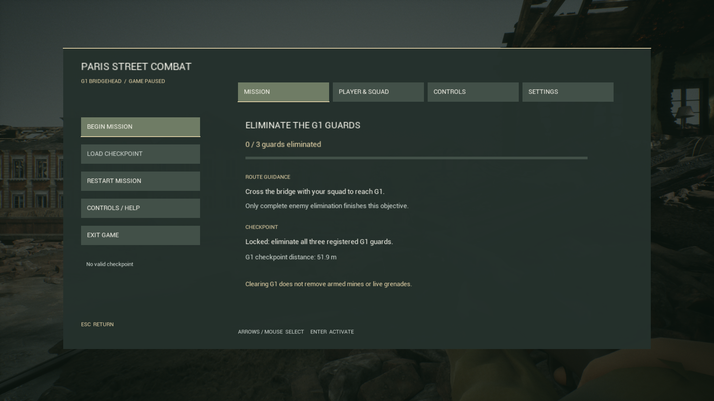
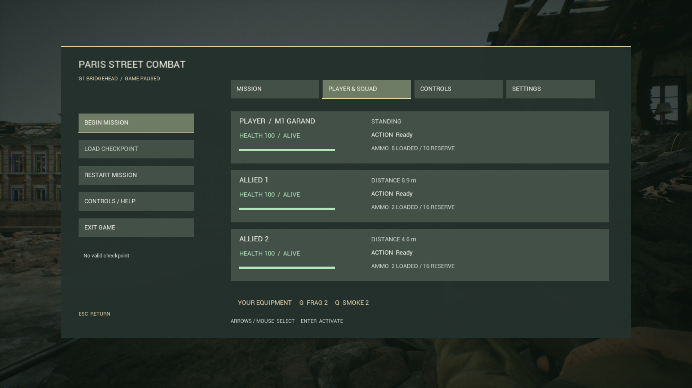
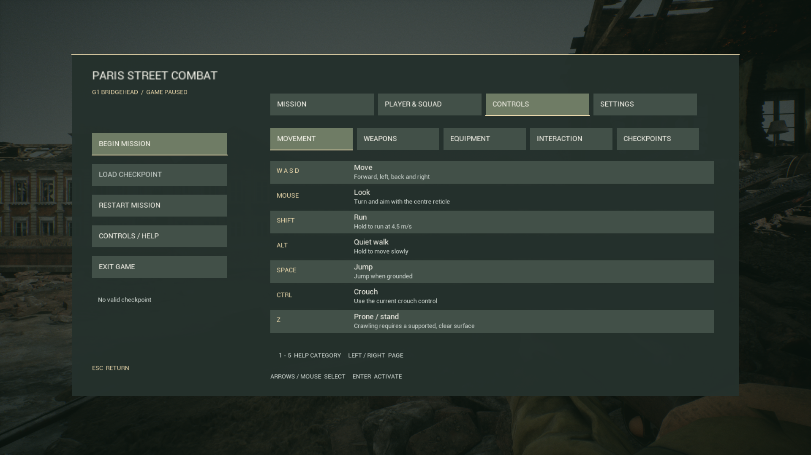
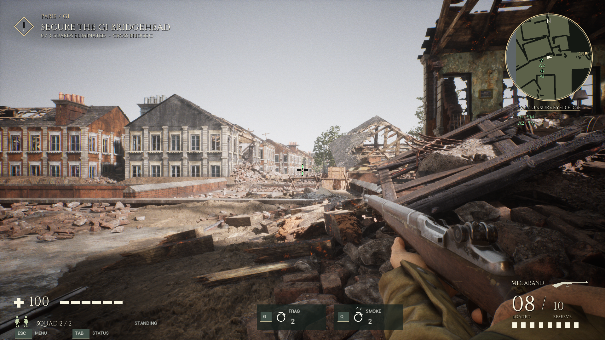
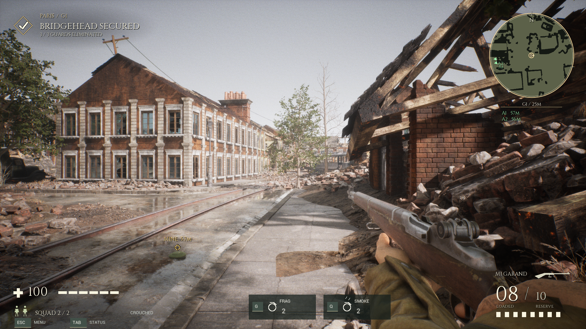

# 作战菜单与操作帮助结果

2026-10-11。帮助、任务、人物与小队信息及情境提示已完成，合并手榴弹、烟幕、地雷、弹药补给，交付一个正常统一试玩候选。等待用户人工体验与选定；正式 enemy-clear 基线保持。先形成[实施文档](COMBAT_UI_IMPLEMENTATION_20261011_ZH.md)，再在独立源开发。

## 正常试玩

根 `PLAY_COMBAT_UI.cmd` 和现有 `PLAY_TACTICAL_EQUIPMENT.cmd` 都进入 `tmp/Playtest-G1-CombatUI-20261011`。Enter开始；Esc打开作战暂停菜单，Tab直接查看人物与小队。菜单支持鼠标，左右切页、上下选择左侧操作、Enter激活，帮助页1–5切分类。F9读取、F6重开有确认，默认取消；已有保存窗口继续优先处理原交互。

人物、任务、装备数值均从现有实际对象读取。当前标签英文，沿用已cook字体。设置实现详细/简洁引导与HUD大小；会话偏好不进入存档。未实现的ADS、按键重绑和中英切换不显示可用按钮。

独立 UserDir `G1CombatUI20261011`，prefix `ParisCombatUIV1`；旧正常用户档没有迁移或覆盖。运行入口无自动输入、探针、观察员、AI暂停或后台solo配置。UE现有两个Editor保持开启，诊断Game自行退出。

## 实际画面

任务只用三个登记敌军全灭完成，过桥是路线提示；显示圈内保存解锁和实际距离，明确未解除危险。

人物与小队显示真实血量、存活、姿态/动作、装填与备用弹药、距离及装备库存；没有新设军衔/技能或隐藏敌人列表。

五类帮助覆盖移动、武器、装备、交互与保存。G/Q按住准备松开投掷、hold E两米拆雷、箱子有限备用弹药、圈内保存均有说明。

原血量、准星、枪械资源和玩家中心雷达保留；新增带按键和计数的G/Q装备、姿态、Esc/Tab入口。首次相关交互有短引导，原目标检测、拆雷进度与保存进度/成功窗口继续使用。

实际保存成功并关闭成功窗口后，原E保存选项与新增保存引导均消失；仍然保留真实地雷提示。

图为实际UE帧，没有生成场景或替换模型。1080p与720p各十幅UI/帮助/设置/HUD原图、确认窗口已复看：题目/分类匹配，没有裁切、溢出或互相覆盖。低分辨率细节文字较小，最终可读性仍由用户体验确认。文档图公开安全审核、精确尺寸/哈希、文档链接及负向ignore规则已登记；raw证据保留私下。

## 同一最终Game实测

最终 `candidate_ui_v5` Game SHA-256 `95132229e0281acea0535e00ab2b54f22df749bba1ed4d976b00496da9325db9`。以下19项全部在此Game实际独立运行，退出码0；没有将父候选通过结果算作本轮实跑。新UI探针仅用正常controller按键/鼠标事件，不改血量/库存/AI或传送。原回归探针仍有其明示的定位、AI hold、伤害端点/有限载荷夹具，不能算自然交战。

| 流程 | 结果 | checks / events记录 |
|---|---|---:|
| ui_pause | pass_ui_pause | 6 / 0 |
| ui_equipment_pause | pass_ui_equipment_pause | 7 / 0 |
| ui_pages | pass_ui_pages | 11 / 0 |
| ui_confirm | pass_ui_confirm | 9 / 0 |
| ui_pages_small | pass_ui_pages_small | 11 / 0 |
| menu | pass_menu_input | 37 / 0 |
| enemy_clear | pass_enemy_clear_checkpoint | 27 / 0 |
| p1 | pass_p1_ammo_radar_inventory | 22 / 0 |
| throw | pass_native_throw | 0 / 9 |
| smoke | pass_native_smoke | 0 / 19 |
| interactions | pass_native_interactions | 0 / 29 |
| mine_range | pass_native_mine_range | 0 / 16 |
| mine_post_clear | pass_native_mine_post_clear | 0 / 5 |
| mine_post_clear_frag | pass_native_mine_post_clear_frag | 0 / 5 |
| save_equipment | pass_native_save_equipment | 0 / 16 |
| restore_equipment | pass_native_restore_equipment | 0 / 11 |
| restore_legacy | pass_native_restore_legacy | 0 / 9 |
| restore_v16_equipment | pass_native_restore_equipment | 0 / 11 |
| performance | pass_native_performance | 0 / 14 |

暂停实测冻结游戏时间、玩家/全NPC位置、已释放手雷位置与引信、烟幕剩余寿命；关闭后继续剩余状态。菜单不执行移动/开枪/换弹/G/Q/E，鼠标返回不漏成一枪，释放移动键不粘住，普通移动可恢复。投掷准备Esc优先取消不扣资源。

原菜单37项、enemy_clear27项与P1回归检查原输入/枪械资源/动作和保存入口。圈内E实际保存显示原进度/成功窗口；真实双槽checksum/write/readback、新进程活引信/烟/库存/已拆雷/箱子状态恢复、复制旧v16和原V5兼容通过。额外弹药、补给ledger、库存、配置、引信守恒、重复ID和不存在陷阱等负向载荷继续被拒绝。没有加回过桥、盟军到达、站立/静止等保存任务门槛。

实际陷阱拆除/补给、两米边界/墙遮挡、烟幕行为、手榴弹取消与有限消耗回归通过。清场后真实地雷/手雷伤害仍能使玩家Lost，关闭旧保存窗口；F9确认读回、F6确认重开保留原世界与资源生命周期。

本机当前六人、原AI、1080p画质2、cap60、Editor开启的16秒装备合并短测：901个样本，平均59.97FPS，P95帧时间18.24ms。不是无上限FPS、大量NPC压测、完整自然交火或长期稳定性验收。

## 保护闭合与失败记录

精确67文件源 `Unreal/Variants/G1CombatUI20261011/Project`，manifest `a69ad1f0ebeb3d7939aaf14e4b51cc585acec7bfbe005288a2043e4791bd0c8f`，authoring `tmp/g1-tactical-equipment-20261010/candidate_ui_v5/Project`。在父63文件上添加四个非反射UI/诊断文件；八个已有文件只接绘制/输入/生命周期和opt-in确认回归。派生controller仅加非反射方法，没有新成员或反射字段，不改变cooked布局。

1754 native文件、正式52源/原Game、父63源/正常包、原与地雷用户档、Catalog与旧反射精确匹配。保存载荷/校验/事务、开枪/换弹/弹药/导航/匍匐及装备算法保留原字节范围。v2→v3去除换行差异后仅opt-in截图探针改变；v3→v4仅保存引导有效期及其诊断断言改变；v4→v5仅UI探针实际点击Ready开始，不再假定旧选择。详见本地 `tmp/g1-tactical-equipment-20261010/candidate_ui_v5/ui-protection.json`、`tmp/g1-combat-ui-20261011/DELIVERY_20261011.json` 和各独立原始结果。

MI032保留首候选受保护API/TObjectPtr编译失败；MI033保留第二候选截图同帧切页错位，等待截图完成才切页。MI034保存类引导残留改为按当前操作可用性清除；MI035将旧v16 seed用例正确映射为原restore_equipment模式，最终实跑兼容。MI036明确点击原Ready开始按钮，正常退出无RESULT不算通过。实际像素重新验收。没有覆盖失败源/日志或把错位图改名充当通过。相关已有MI019/022/023/024/028/029/031防止反射、旧gate和失真验收再犯。

日志仍有父地雷候选既存的 transient static-mesh UVChannelData handled ensure；父原日志已核对同样信息，本轮未修改地雷模型/材质代码来消除该警告。运行继续且检查退出0，但不能声明日志零警告或GPU启动问题已根治。

尚未人工自然试玩、全动作/所有画面比例/失焦设备组合、大量NPC、第二机或新UI Editor/PIE/cook验收。没有自动选正式、Git提交/推送、SFTP、录像或清理。下一步由用户统一试玩反馈决定局部调整与正式选定。
