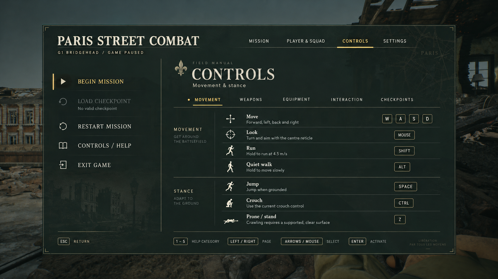

# 战地手册 UI 实施文档

2026-10-11。用户认可生成的战地手册方向并要求应用到实际 UI。从 CURRENT_UI_REVIEW.json 标识的精确67文件 candidate_ui_v5 继续；不从旧正式52文件重新开始而丢失装备和菜单内容。

## 本轮范围

统一任务、人物与小队、帮助、设置四页：象牙白/黄铜/深绿配色，文字页签与选中下划线，带小图标的侧栏操作，细分隔线，固定两行说明基线，右侧紧凑按键框与移动/姿态图标。标题使用现有 Cinzel，正文使用随包提供的清晰 Roboto 字体。任务进度、真实人物数值、确认窗口和装备提示采用一致层级，原已选战斗 HUD 构图保留。

效果图是美术参考，不整张贴到界面，也不冒充UE验收截图；文字、真实数值、按钮与焦点继续可交互。省略效果图额外的小标语和重复城市插画。

## 已读失败与本次不同点

已读 Failures/README.md、MI013及MI032–036：MI013指出仅Composite字体可能不绘字，应沿用runtime UFont适配并复看实图；MI032避免不兼容API和反射布局变化；MI033等待截图完成再切页；MI034保存成功后立即移除保存引导；MI035旧v16恢复仍用真实restore_equipment模式与单列seed身份；MI036实际点击Begin，不假定原菜单Enter必开始。

本次只改绘制、字体、布局及相配的点击坐标，保留既有输入/暂停/确认状态机。模型、手指、枪械资源事务、全灭单独完成、圈内E、schema/checksum/写盘读回、装备算法、native、导航与AI、旧源码和用户档全部保护。不新增反射字段、不保存原生资产、不recook、不自动正式采用/清理/发布。

## 顺序、早验收与停止条件

先冻结父源、旧正常试玩与用户档及native身份，再创建独立候选。实现真实字体和线条图标、固定列网格，绘制与点击区域一致；诊断点击坐标明确随设计更新。

先Game构建与1920×1080、1280×720全页实图检查，核对七项移动键位、字号、两行基线、分类选中、设置实际生效。缺字、裁切、错位或点击落到错误操作即停，修正后再进入回归。

随后跑真实鼠标/键盘菜单、确认默认取消、真暂停/恢复/输入隔离和危险计时；验证清场原存档、成功后提示消失、新进程与旧档/旧装备复制恢复。实际实跑与逐字承接明确分开，不把父结果称本轮实跑。最后给独立正常统一试玩，无自动输入或探针；UE现有Editors继续开启，由用户统一复验。

父保护漂移、反射/cooked不兼容、缺字体、可见按钮/命中错位、误导状态、存档提示残留、资源/暂停/确认回退、写盘读回/恢复失败或结果不完整均停止。每个失败身份原样保留，先定位再建立新候选。外观好不能豁免功能失败。

## 已批准生成参考

首个视觉候选按MI037停止交付：runtime点字号超出参考像素布局，虽然菜单交互检查通过，实图仍有按键框/设置说明溢出。v2转换像素字号为四舍五入的字体点数，再取两个分辨率实图；v1源和raw图片不改。这是纠正实际字体度量，不是放宽排版门槛。

原实际帮助页为COMBAT_UI_HELP_20261011.png。原始prompt和私下对比说明继续保存在tmp/g1-combat-ui-visual-20261011。
