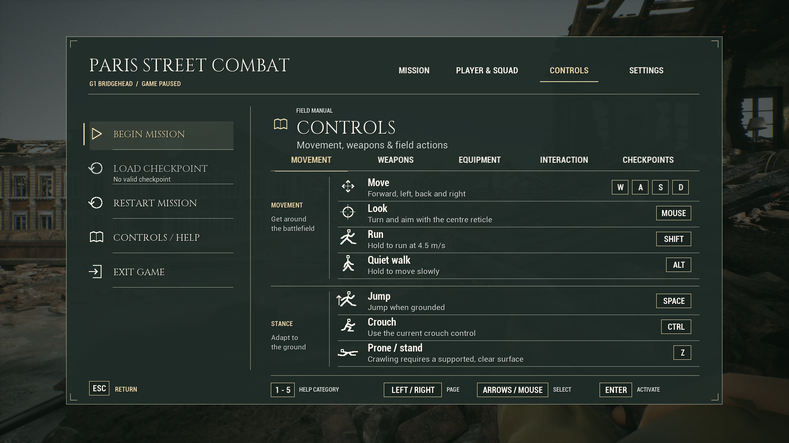
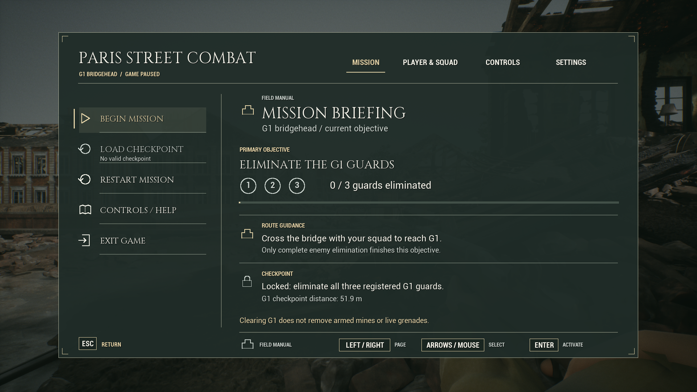
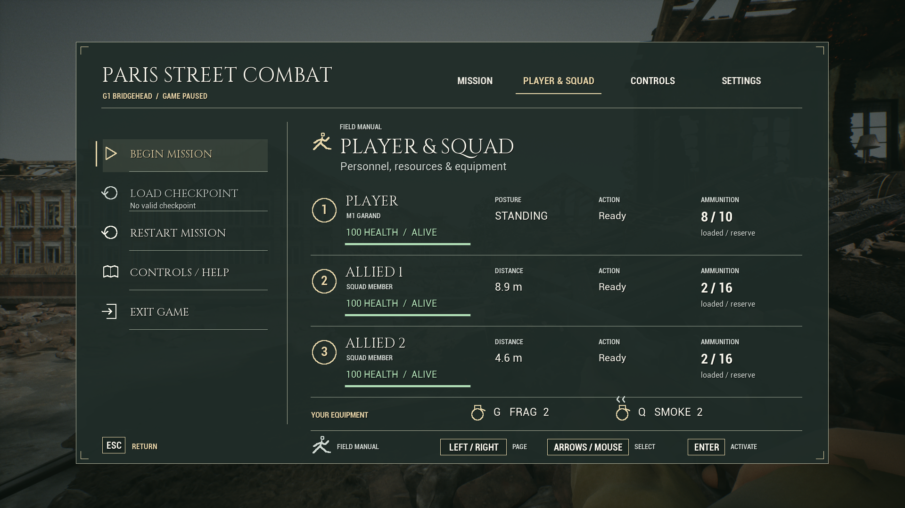
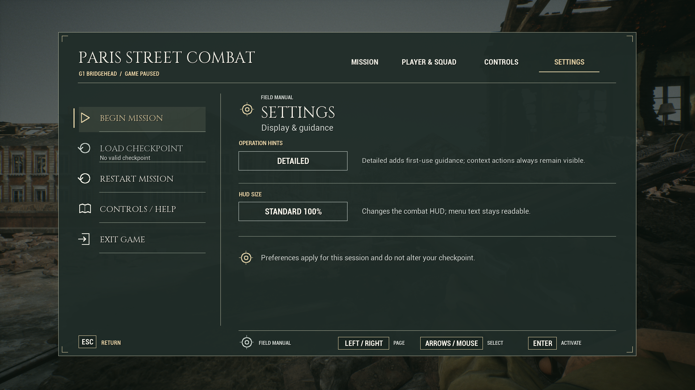
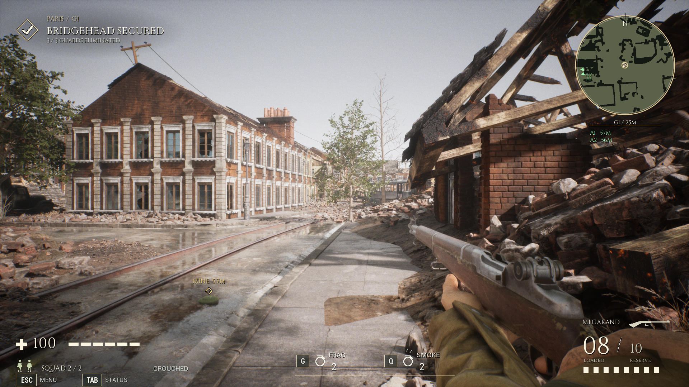

# 战地手册 UI 优化结果

2026-10-11。从candidate_ui_v5将用户选定效果稿实现为真实交互界面，统一试玩已准备，等待人工外观/玩法复验；正式enemy-clear基线保持。

## 使用与改动

根PLAY_COMBAT_UI.cmd、PLAY_FIELD_MANUAL_UI.cmd、PLAY_TACTICAL_EQUIPMENT.cmd进入tmp/Playtest-G1-FieldManualUI-20261011。Esc打开作战菜单，Tab在战斗中直达人物与小队。四页统一Cinzel标题/Roboto正文、文字页签和选中线、小图标、细分隔线、固定两行说明、右侧紧凑按键；移动/姿态分组留白，人物状态按列对齐，任务和存档锁定读取实际状态。G/Q装备HUD减轻底板，原血量、枪械与雷达构图保持。

鼠标/键盘、设置实际效果、默认取消确认、原Ready/Lost操作和存档窗口优先级保持。真实存档成功确认后，E保存操作和首次引导仍立即消失。模型、手指、声音、枪械、存档、装备、导航与AI原逻辑保留。

独立UserDir G1FieldManualUI20261011、prefix ParisFieldManualUIV1，旧用户档不迁移/覆盖。正常入口无探针、自动输入、observer或资源/AI覆盖。现有两个UE Editor继续开启；本轮是Game实跑，不冒称新Editor/PIE/cook通过。

## 同一最终Game验收

Game SHA-256：b40590bdec9c27d4a2c2f321ae32c0eca12936923f36d003872df2dabc113d11。精确69源：Unreal/Variants/G1FieldManualUI20261011/Project；manifest SHA-256：1d7e1fa292e463c2f501be44d346c85f2a3569f93a2d5bc3394bd433a47f9887。匹配authoring：tmp/g1-tactical-equipment-20261010/candidate_field_manual_v2/Project。

以下19项均在此最终Game实际运行，结果完整通过、exit0；未把父结果称为本轮。新UI探针仅经controller输入，不改玩法资源；原回归仍有其明示定位/AI hold/伤害端点/有限负向载荷夹具，不算自然人工交战或大量NPC压测。

| Check | Actual result | Checks / events |
|---|---|---:|
| ui_pause | pass_ui_pause | 6 / 0 |
| ui_equipment_pause | pass_ui_equipment_pause | 7 / 0 |
| ui_pages | pass_ui_pages | 11 / 0 |
| ui_confirm | pass_ui_confirm | 9 / 0 |
| ui_pages_small | pass_ui_pages_small | 11 / 0 |
| menu | pass_menu_input | 37 / 0 |
| enemy_clear | pass_enemy_clear_checkpoint | 27 / 0 |
| p1 | pass_p1_ammo_radar_inventory | 22 / 0 |
| throw | pass_native_throw | 0 / 9 |
| smoke | pass_native_smoke | 0 / 19 |
| interactions | pass_native_interactions | 0 / 29 |
| mine_range | pass_native_mine_range | 0 / 16 |
| mine_post_clear | pass_native_mine_post_clear | 0 / 5 |
| mine_post_clear_frag | pass_native_mine_post_clear_frag | 0 / 5 |
| save_equipment | pass_native_save_equipment | 0 / 16 |
| restore_equipment | pass_native_restore_equipment | 0 / 11 |
| restore_legacy | pass_native_restore_legacy | 0 / 9 |
| restore_v16_equipment | pass_native_restore_equipment | 0 / 11 |
| performance | pass_native_performance | 0 / 14 |

1080p十幅逐张复看；720p十幅通过总览及原图检查，关键帮助/设置字号、footer按键框、两行说明、页名/分类一致。确认、暂停活手雷、投掷/补给引导、实际保存成功与成功后干净HUD亦复看。实施文档生成参考图明确标为效果稿，不混入实测图片。

1754native、父67源/正常试玩、正式52/Game、模型手指声音、Catalog与原用户档精确。原反射布局不变，三个父文件只改绘制/命中坐标、诊断坐标及非反射Canvas访问方法，并增加两份绘制include；其余父文件以及UI输入/暂停/确认/引导逻辑经限定反向比较精确。Roboto随包保留安装分发的Apache2原许可和来源记录。

MI037原样保留v1功能通过但实际字体溢出的失败；v2依据本机Slate96DPI/72点规则将预期像素字号转点数，不覆盖v1源/结果/图片。未自动正式采用、Git/SFTP/视频发布或清理。六人短cap60性能用例保留限定范围，不作为完整动作/长期/第二机/大量NPC通过。

19份最终日志已复核，没有fatal或新增handled ensure；既存地雷静态网格UV通道handled ensure及原编译警告继续记录，不声称零警告或修复了此前资产诊断。

## 实际UE画面

