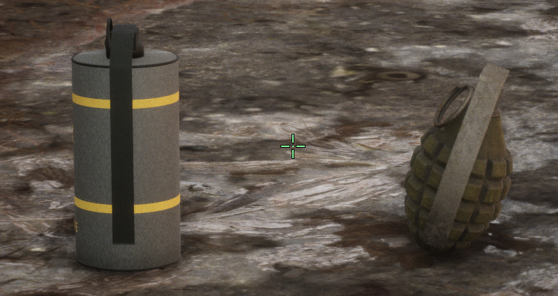

# 手雷与烟雾弹模型替换结果

2026-10-11。本次先完成[实施文档](GRENADE_MODELS_IMPLEMENTATION_20261011_ZH.md)，再实施。已替换两种基础几何占位，并完整承接当前战地手册、地雷/补给及第三人称死亡候选；提供独立统一试玩，等待人工评审。

## 资产优先的结果

先读 `Assets/ASSET_INDEX.md`，查询登记资产、grenade/smoke/M8/M18/MK别名、盟军装备与相关动画道具。两个旧grenade条目仅是占位；盟军包存在MkII材质/贴图，完整网格位于 `SK_WWII_US_Paratrooper_equipment` 的第9材质槽（零起点），不是独立网格登记。只读UE导出后单独提取手雷分区，去除角色/骨架，不覆盖装备原件。

烟雾搜索没有独立可用罐体模型；烟图集、烟特效、投掷动作及无关动画炸弹不作为模型。随后制作简单独立外壳。采用[1943美军TM9-1981第36节/图15](https://www.bulletpicker.com/pdf/TM-9-1981-1943.pdf)的灰罐身、黄色识别带/HC/SMOKE外观，约6.6×6.4×14.8cm。后期军绿照片仅辅助接缝/磨损观察，不冒充1944涂装/批号。只做游戏外表，未制作内部构造或真实机制。史料图未做贴图、未分发。

| 道具 | 来源 | 三角面 | 纹理与导出 |
| --- | --- | ---: | --- |
| Mk II手雷 | 已有许可盟军装备的完整分区 | 2,733 | 保留原几何/UV，1024级原D/N/ORM衍生PNG；独立GLB |
| AN-M8风格烟雾弹 | 团队新建简单外壳 | 7,562 | 圆滑罐、卷边、连接压柄/拉环、灰漆黄标、1024级烘焙PBR；独立GLB |

新进程分别导入GLB，检查正/侧/后/底视图。真实UE渲染如下，左烟雾弹、右手雷。此图来自独立道具摄影测试：已验证的补给点脚底坐标、隐藏该测试的补给箱显示、近景摄影机；没有改变普通游戏摄影机。这是外观证据，不能当作自然投掷落地/连续接触验收。

## 统一试玩与精确来源

入口：[PLAY_GRENADE_MODELS.cmd](../../../tmp/Playtest-G1-GrenadeModels-20261011/PLAY_GRENADE_MODELS.cmd)，全部试玩文件位于 `tmp/Playtest-G1-GrenadeModels-20261011`。G/Q按住准备、松开投掷，准备时Esc取消；原Esc手册、Tab人物/小队、E拆雷/补给/清场后保存保持。运行数据在 `Windows/WW2FranceLiberation/Equipment/Grenades/Frag` 和 `Smoke`，不能只复制exe。

最终候选 `candidate_grenade_models_v5`，Game SHA-256 `a927caa398cdba4d12b8d9ea9a6e05977f66263c504d70635adc195a8cf4eb59`。独立74文件源码：[G1GrenadeModels20261011](../../../Unreal/Variants/G1GrenadeModels20261011/SOURCE_MANIFEST.json)。实际作者工程仍在 `tmp/g1-tactical-equipment-20261010/candidate_grenade_models_v1/Project`，该历史文件夹名中保存最终v5；各次编译的独立源码快照/日志/回执保留，不能按文件夹名删除此活跃工程。

普通入口使用独立 `G1GrenadeModels20261011` UserDir、`ParisGrenadeModelsV1`前缀，没有探针、自动操作、摄影机或AI/资源覆盖。正常包入口与最终Game/外观输入字节已核对；新的完整普通试玩等待用户，不声称已做本次人工或第二机验收。

## 保护与验证

起点为上一版死亡/战地手册73源码。源码仅改 `ParisTacticalEquipment.cpp` 的Prop显示及显式开启的模型摄影测试，增加 `ParisGrenadeMesh.inl`。其余72文件逐字节一致，所有人物/手指/武器绑定/枪械/AI/保存实现未改；BeginThrow、CommitThrow、PlayThrow、EndThrow、ThrowTick、BallTick、Blast函数文本一致。原hand_r连接中心、动作、引信、3.3cm扫掠球、轨迹/伤害/烟幕时间和保存字段不变。网格/材质瞬态构建，不参与碰撞/导航、不写native包。1754原生保护文件、父73源码、父普通92文件、原用户档和Catalog身份一致。

同一最终Game的13项独立实跑全部正常退出并通过：

| 范围 | 实测内容 |
| --- | --- |
| 模型/装备 | 真实G/Q准备、取消不扣库存；投掷唯一提交、回枪；烟幕双方感知遮挡/记忆/消散，原枪弹穿烟造成伤害 |
| 枪械/任务 | P1共22项检查，原射击/换弹资源；敌军全灭checkpoint共27项检查，显式E与实际双槽写盘/读回 |
| 地雷/补给 | 取消/持续E拆除、有限补给、重复空箱不增弹、原接触伤害 |
| 存读档 | 活动弹体/烟幕、已用补给/地雷状态实际保存；跨进程恢复、计时不重置、不重复补给；复制旧V5和旧v16装备档恢复；死亡NPC末态停止 |
| UI/死亡 | 装备准备取消和真实暂停时引信/烟幕计时冻结；实际手雷自伤死亡、原第三人称倒地、延后YOU DIED、正常重开清理 |
| 性能记录 | 当前六角色、正常AI、真实G/Q、1080p画质2/cap60；未新增NPC，不作为大量NPC压测或全MVP性能验收 |

详细身份/13项结果见 [交付清单](../../../tmp/g1-grenade-models-20261011/DELIVERY_20261011.json)，保护清单见 [protection.json](../../../tmp/g1-tactical-equipment-20261010/candidate_grenade_models_v5/protection.json)。大多数动作/保存场景为明确的隔离fixture；性能场景的 `PERFORMANCE.json`记录正常AI范围，不能套用其他检查的通用隔离描述。不是人工连续战斗验收。

## 已知边界与失败保留

原Hold投掷姿态的手位于画面下沿，道具下半部仍会被原手/画面边缘遮挡。本次保持手指、手臂、动作和普通摄影机；未声称完成新握姿接触、整段动作或自然弹体落地外观验收。实际手持/准备/释放原图留在 `tmp/g1-tactical-equipment-20261010/checks/models_gmv5` 和 `throw_gmv5`。人工试玩重点是新外观、投掷后的回枪及存读档。

已读MI024/028/030/038/039/040，本次新增[MI042](../../../Failures/MI042-20261011-grenade-model-build/ANALYSIS.md)：空场景World未创建、机械替换多余闭合括号、碎石边拍照坐标拒绝，以及数字通过但地面模型被原箱体/视角遮挡。v1失败编译、v2/v3原图、v4重复未变源构建均留作证据，最终v5真实近景才确认模型显示。摄影修正只在显式诊断分支，无普通游戏改动；未放宽碰撞、导航、资源或保存门槛。

现有UE编辑器保持开启。正式enemy-clear52入口、课程报告/发布包不变；本次未正式采用、Git/SFTP发布或删除原版本。

## 可复现制作文件

手雷提取/整理脚本：[extract_frag.py](../../../Tools/Integration/GrenadeModelsV1/extract_frag.py)、[finish_frag.py](../../../Tools/Integration/GrenadeModelsV1/finish_frag.py)。私有成品：[MkIIExisting.blend](../../../Assets/LocalWorking/Experiments/GrenadeModels/20261011/frag_finish_v1/MkIIExisting.blend)、[MkIIExisting.glb](../../../Assets/LocalWorking/Experiments/GrenadeModels/20261011/frag_finish_v1/MkIIExisting.glb)。

烟雾制作脚本：[create_smoke.py](../../../Tools/AssetCreation/GrenadeModelsV1/create_smoke.py)。私有成品：[ANM8SmokePacked.blend](../../../Assets/LocalWorking/Experiments/GrenadeModels/20261011/smoke/finish_v1/ANM8SmokePacked.blend)、[ANM8Smoke.glb](../../../Assets/LocalWorking/Experiments/GrenadeModels/20261011/smoke/finish_v1/ANM8Smoke.glb)。模型/PBR/GLB和原始参考保留私有；精确允许的文档图仅包含渲染像素。
