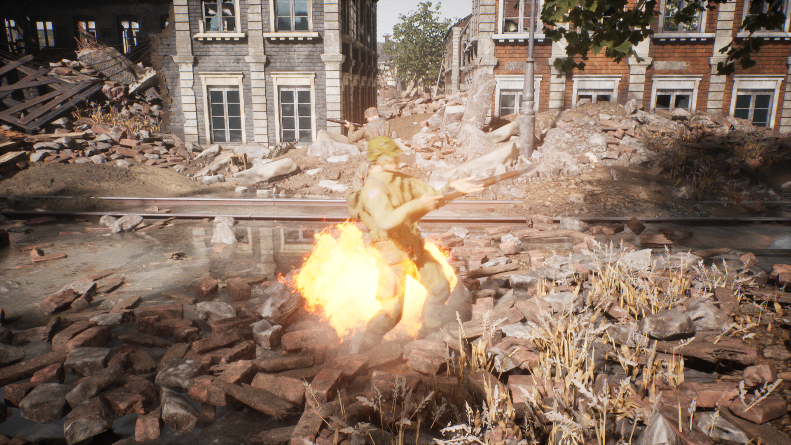
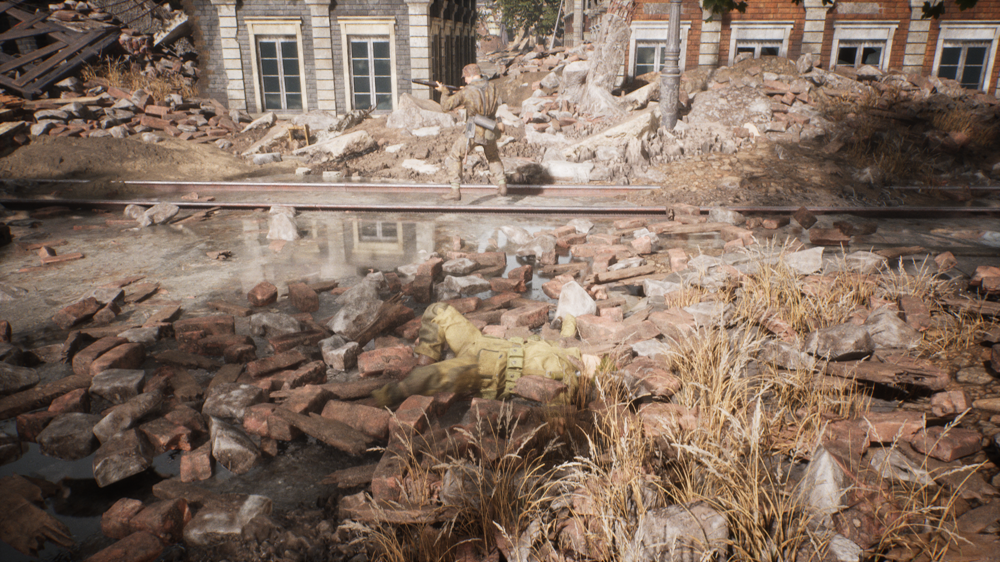
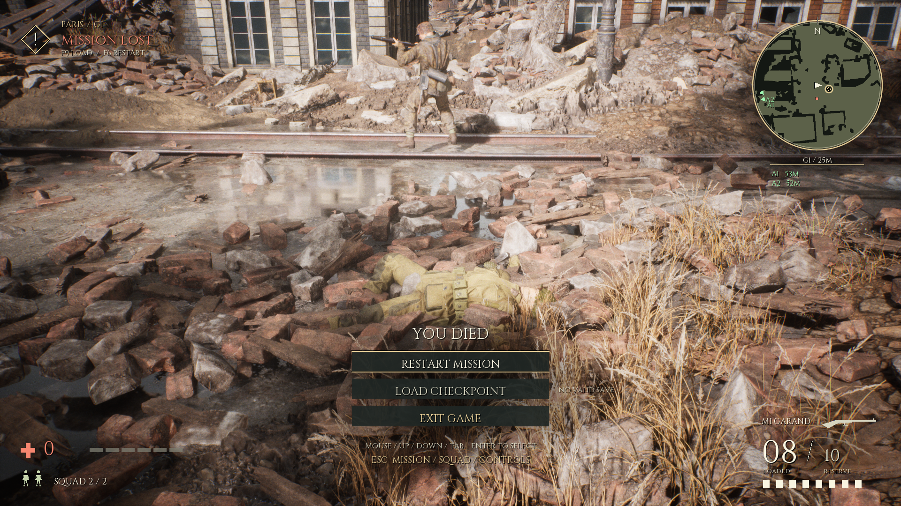

# Player death presentation and trial placement result

11 October2026. Local unified candidate ready for human review. Five actual death runs and19 existing UI/equipment/save/regression runs pass on the same final Game; all exit0. Formal selected enemy-clear52 and published course package remain unchanged.

## Resulting behavior

All newly dead players use the original damage/PC_Die/Lost authority immediately. A transient third-person camera reveals the original full body and watches original Rifle_Death_3 to its3.933333s terminal pose; after its end plus0.25s, YOU DIED and original restart/load/exit controls appear. The mine witness completes at4.184637s. During collapse, HUD/menu/restart/load/fire/equipment input are suppressed. Restart removes the old world/camera and returns an alive100HP player. NPC saved corpses still restore directly stopped at their terminal pose; no replay.

Mine and frag blasts now visibly produce a brief warm fire burst, dust and light. Existing compatible cooked fire material uses11x11 SubUV with transient runtime curves explicitly not baked and dynamic usage flags. Mine diagnostic records24 fire particles, alpha0.891810, plus18 dust particles; unmodified early images show visible fire. Fire particle life0.65s/dust1.6s; no extra collision, cover or persistent fire damage. Original blast radii/occlusion/damage/audio remain exact. v6 fixes several rendering prerequisites together; the final pass does not isolate one parameter as the sole cause.

Three newly added root trial wrappers were relocated with exact frozen hashes to private tmp evidence. All new trial packages and launchers stay in tmp/Playtest-*/; the parent normal package remains byte exact. Existing formal root launcher is preserved.

## Exact candidate

Source: `Unreal/Variants/G1PlayerDeath20261011/Project` (73 files); manifest SHA256 `1023d2a2a5bd6d239e4fc17481dc3b670910f709d4a191c6048df1c8c2a6f26a`. Game SHA256 `290b51b5648c73261e119edbef8d0f7fbb2e9088de4126262afc8cb92988ea21`. Authoring: `tmp/g1-tactical-equipment-20261010/candidate_death_v6/Project`. Normal trial: `tmp/Playtest-G1-DeathPresentation-20261011/PLAY_COMBAT_UI.cmd`. Independent UserDir `G1DeathPresentation20261011` / prefix `ParisDeathPresentationV1`; no old-save migration.

Normal launch has no probe, automatic input, observer or AI/resource override. Editor50836/51148 remain open; this Game validation adds no new Editor/PIE/cook acceptance.

## Actual checks and scope

| Run | Final status |
| --- | --- |
| death_mine | pass_player_death_mine |
| death_frag | pass_player_death_frag |
| death_damage | pass_player_death_damage |
| death_crouch | pass_player_death_crouch |
| death_prone | pass_player_death_prone |
| ui_pause | pass_ui_pause |
| ui_equipment_pause | pass_ui_equipment_pause |
| ui_pages | pass_ui_pages |
| ui_confirm | pass_ui_confirm |
| ui_pages_small | pass_ui_pages_small |
| menu | pass_menu_input |
| enemy_clear | pass_enemy_clear_checkpoint |
| p1 | pass_p1_ammo_radar_inventory |
| throw | pass_native_throw |
| smoke | pass_native_smoke |
| interactions | pass_native_interactions |
| mine_range | pass_native_mine_range |
| mine_post_clear | pass_native_mine_post_clear |
| mine_post_clear_frag | pass_native_mine_post_clear_frag |
| save_equipment | pass_native_save_equipment |
| restore_equipment | pass_native_restore_equipment |
| restore_legacy | pass_native_restore_legacy |
| restore_v16_equipment | pass_native_restore_equipment |
| performance | pass_native_performance |

Death runs total32 assertions. Mine/frag use original hazards, crouch uses real Ctrl, prone uses real Z at the earlier measured flat site, standing/posture death uses original PC_ApplyDamage endpoint damage. NPC AI is paused for finite isolation; mine/prone relocation is a declared fixture, not a new gameplay spawn or natural combat claim. The existing19 include real mouse/keyboard menus, weapon/ammo checks, paused actors/fuses/smoke, clear-only checkpoint and success window/hint closure, mines and post-clear deaths, new-process/current/copied-v16/legacy restores and six-actor short performance. Actual1080p/720p UI and death/confirmation/save frames reviewed. No added NPC stress, long-term, second-machine or human perceptual acceptance claimed.

900 samples over 14.997s; average frame 16.680ms, p95 18.452ms, average GPU 9.018ms. Current six actors with normal AI and real G/Q input, 1080p quality2/cap60, Editors open; no new NPC or relocation/hold in this performance run. This is a capped short witness, not uncapped maximum FPS or long stress acceptance.

## Protected baseline and retained failures

Strict reverse-delta comparison: seven parent files adapt only presentation lifecycle/UI, blast render helper and later post-clear probe actions; all other parent files and reflected layout exact. 1754 native assets, models/rig/fingers, gun/ammo/damage, checkpoint schema/checksum/readback, original NPC terminal restore, navigation/AI, Catalog, formal52, parent69/normal package and original user saves remain exact. New source adds four nonreflected helper files.

MI038 preserves failed v1 compile; MI039 preserves v2 numeric pass but bad framing/footer; MI040 preserves v3/v4/v5 insufficient fire pixels and read-only audits; MI041 preserves the prior rubble-site prone-admission failure. Final v6 is a fresh identity. Native UV handled ensure and inherited compile/material/collision warnings remain recorded. Raw frames/logs/source/receipts remain private, reviewed document images are exact allowlisted below. No automatic adoption, Git commit/push, SFTP publication, recording or broad cleanup.

## Actual document images

