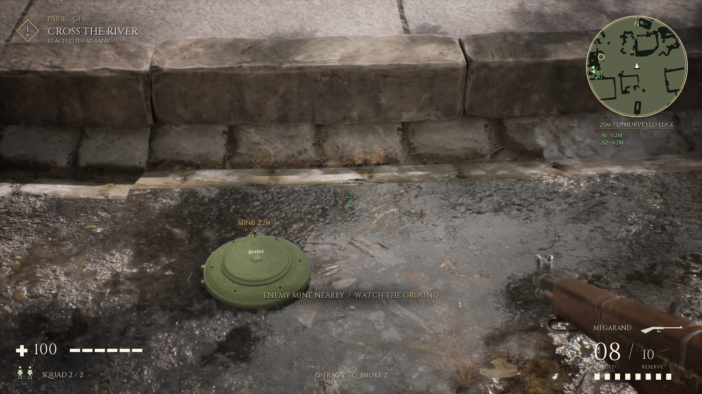
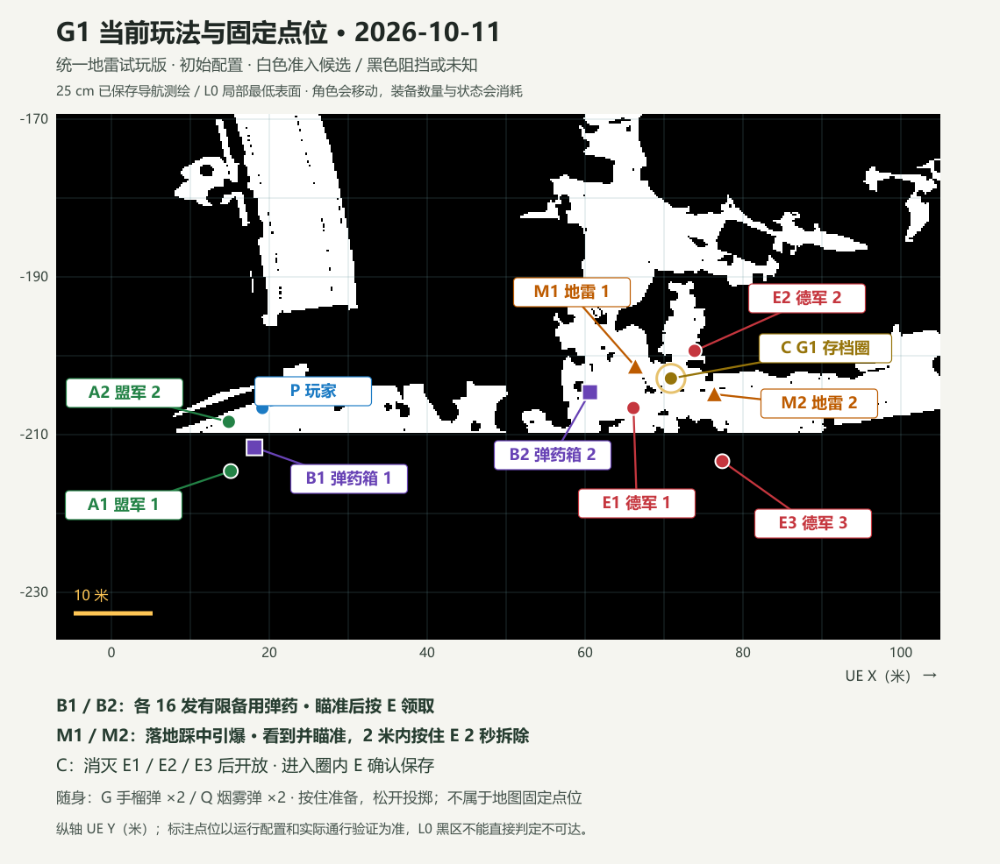

# 地雷修订与统一试玩结果

2026-10-11，本地候选，等待用户人工试玩选定。依据[实施文档](PRESSURE_MINE_IMPLEMENTATION_20261011_ZH.md)，从装备v16继续，正式enemy-clear v3保持。精确身份与全部收据索引见 `../CURRENT_EQUIPMENT_REVIEW.json`。

## 外观与规则

灰白格纹圆筒改为独立军绿盘形地雷：圆滑外壳、压盘、接缝、六处紧固件与有支撑的提环，烘焙PBR和可辨标记。28cm圆盘、约7cm高、含提环宽约32cm、10809三角形、1024贴图。属于泛化游戏道具，不声称真实型号或真实引信模拟；只观察外部参考，不复用参考照片为贴图。Blender源/GLB、重新导入和四视图均保留在本机 `Assets/LocalWorking/Experiments/PressureMine/20261011-v1/`。

复用已cook的PBR shader创建独立transient材质与渲染网格，未修改原枪械材质/native包，也没有重cook。位置仍是已实际验证的Trap1/Trap2；稳定存档ID不改。

图为真实Trap2点位的40°细节视角、NPC暂停夹具；另保留90°普通视角原图，不能把该取景当作用户自然交战或最终美术选定。

- 存活角色落地且脚底胶囊覆盖地雷才引爆，脚底高度差最多18cm；玩家、盟军、德军均可触发。以角色胶囊地面接触近似脚底覆盖，未新增骨骼或足部IK。近旁100cm、空中经过不误爆；Spent只爆一次。
- 实际视线发现后，画面显示位置和距离。墙体或烟幕阻挡时不显示提示，也不能隔墙拆除。
- 平面两米内看到并瞄准，按住E两秒拆除；205cm拒绝、195cm接受，松开取消，完成后装置与提示消失。原圈内E保存优先，补给仍只给有限备用弹药。
- 三个登记德军全灭即完成并开放保存；无需拆雷。完成后仍能遇到危险，玩家死亡转Lost，关闭成功/保存窗口并开放原重开／读档操作。实际盟军死亡进入伤亡账本；不保存死玩家。

## 实际验收

最终Game为 `afc2839d0980a21745510d6f606f0048ff5b85ca872305a036e6011cf619394e`，匹配63文件源。每项实际运行同一Game，不将旧装备v15/v16的pass改称新实跑。所有探针正常自行退出0；原始日志、结果、截图和User隔离档保留。

| 范围 | 实际检查 |
|---|---|
| 地雷 | 实际UE普通/近景、材质与提示；近旁/空中/落地/一次性伤害；双方原NPC触发与伤亡；两米边界、遮挡、松开取消、完成后消失 |
| 清场后危险 | 真地雷及真实G投掷的手榴弹分别致死；先保存、再受伤，进入Lost并关闭存档窗口；真实F9恢复存档、F6重开 |
| 已消耗恢复 | 原盟军踩雷死亡后真实写盘/readback；新进程F9恢复Spent、伤亡与原终态尸体，三秒后不重播死亡动作 |
| 原操作 | 菜单37项、清场/checkpoint26项、P1弹药/雷达22项；原投掷/取消/唯一提交/恢复持枪、实际箱增量与重复领取拒绝、NPC原生避险和Brain恢复、真实墙体遮挡伤害 |
| 烟幕 | 双方原感知/最后所见记忆冻结/原射击穿烟伤害/消散重新发现；实际浓烟图复看，低对比边缘轮廓可能保留 |
| 存档与兼容 | 活弹体/烟幕/已拆地雷/有限箱状态实际校验保存、新进程读档；精确旧v16配置与旧V5复制档兼容，不重置剩余引信/寿命、不免费补装备或弹药；未知配置、资源/身份/重复对象等负向载荷仍拒绝 |

部分最终RESULT只含最后一次旅行后世界的events；跨世界步骤以完整原game.log的check与UI日志为准，不能将events数当作完整检查数量。除performance外均有明确隔离夹具，不扩大成完整自然交战通过。

当前六角色、正常AI、无摆位/暂停/新增NPC的16游戏秒G/Q短测：1080p画质2、诊断cap60、Editor仍开启，901样本，平均59.97FPS、墙钟帧P95 18.34ms、GPU平均8.65ms，553样本有烟。保留23.77ms最大墙钟帧；UE计数不是CPU利用率或逐帧同步测量。不是无上限FPS、大量NPC、第二机或长期稳定性验收。performance的共用RESULT.scope误写隔离，原件保留并附SCOPE_CORRECTION。

## 保护、失败与交付

1,754 native文件、正式52源/反射字段/原Game/Catalog、原正常用户4文件及七段存档/原资源/导航/输入算法保护通过。人物、手指、枪械、原动作与33条原音效保留。新地雷保留装备的原爆炸声与距离/遮挡伤害，不替换枪械算法。

MI029保存人工清场后真实陷阱致死证据；MI030保留mine_v1近黑UE外观，改正原生三角法线转换后v2通过实图；MI031停止不可达的清场前Waiting追加测试。失败v3不是交付源，当前工具检查源已恢复为精确v2，不放宽入口或修改失败收据。

正常试玩目录为 `tmp/Playtest-G1-PressureMine-20261011`，根 `PLAY_TACTICAL_EQUIPMENT.cmd` 指向此版；正常入口没有探针、自动输入或AI暂停。独立UserDir `G1PressureMine20261011`、prefix `ParisPressureMineV1`，不迁移或覆盖原档。原装备包保留等待人工复验，正式 `PLAY_CURRENT_G1.cmd` 不变。

## 当前玩法点位标注（2026-10-11）

图取当前63文件配置的初始XY；E1/E2/E3均是G1登记守军，不是旧连续任务草案中的G2/G3。M1/M2为两枚地雷，B1/B2为各16发有限补给，C为半径1.8米的现有存档圈。G/Q是玩家随身各两枚装备，没有固定地图位置。角色在运行中会移动，补给和装置会消耗。底图原样来自已保存范围25厘米L0测绘，每轴9像素/米；L0是局部最低表面，黑色包含未知/未准入，不代表标注的实际已验证点位不可达，不混用扩展测绘或一米旧图。图不是新增通行/遭遇验收。

基础G1清场、圈内明确保存与成功窗口、读档和死亡重开属于既有人工通过基线。手榴弹、烟幕、地雷、补给及其状态恢复已在当前统一候选实现并通过上述本机检查，等待用户人工复验；过桥后的连续市中心任务、玩家布雷、NPC动态布雷和大量NPC行为/压测尚未实现或验收。人物/手指/既有枪械及存档事务保留。

现有Editor50836（v16匹配Engine Entry）及51148（原Zen等待）保留；本轮未自动关闭或新进入mine Editor/PIE，不能将独立Game通过当作新Editor验收。新源码若需Editor/PIE，先构建匹配Editor并按实施合同补齐独立道具/音频的Editor入口，不能复用旧DLL。未commit/push、SFTP上传、录像或清理。
