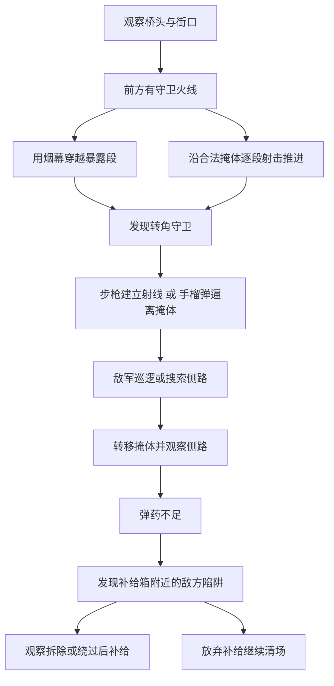

# 巴黎小队战斗装备与补给玩法草案

2026年10月10日。用户明确要求下一阶段增加手榴弹、烟雾弹、陷阱和弹药补给点，参考使命召唤等 FPS 的设计，并选定首轮只做地图上的敌方陷阱。过桥至市中心的连续任务方向保留，本次把战斗工具、NPC反应和资源选择作为玩法设计重点。以下数量和具体规则是首轮候选，不是已实现或已验收内容。

建议先在当前 G1 的独立候选中做出四类工具及对应反应，让同一场战斗出现多种处理方法，再扩展进城路口与市中心。现有正式试玩、模型、手指姿态和已验证枪械逻辑保持。

## 参考游戏的具体机制

《使命召唤：二战》战役的手榴弹可以杀伤，也可以把敌人逼出掩体；队友 Turner 提供弹药，Stiles 提供致命和战术投掷物。其 Aiello 烟雾信号弹用于呼叫迫击炮，不应与遮挡视线的烟雾弹混为一谈。[官方战役说明](https://support.activision.com/content/atvi/support/web/en/call-of-duty--wwii/articles/call-of-duty-wwii-campaign.html)

《使命召唤：二战》多人模式有遮蔽视线的烟雾弹和 S-Mine 44 陷阱。官方烟雾攻略把掩护移动、撤离与行动窗口作为用途；这些多人机制可以借鉴到我们的单人任务，但不能说成该作战役都采用相同规则。[官方装备说明](https://support.activision.com/call-of-duty--wwii/articles/call-of-duty-wwii-multiplayer)、[官方烟雾攻略](https://www.callofduty.com/au/en/blog/archives/tactical-madness-smoke-em--gas-em)

《战地 V》的设计说明把补给站与进攻准备、敌人弹药拾取、侧翼行动并列为资源选择。适合借鉴的是补给对推进路线的影响；本项目首轮使用固定有限补给点，不加入工事建造。[官方玩法说明](https://www.ea.com/games/battlefield/news/battlefield-5-deep-dive-gameplay-changes-and-additions)

上述参考支持工具的战术用途。接下来的携带量、AI反应、交互与地图安排是本项目方案，不是这些游戏的原参数，也不构成1944年巴黎装备型号的历史认证。

## 四类工具分别解决什么问题

| 工具 | 玩家面临的问题 | 首轮机制候选 | 留给玩家的取舍 |
| --- | --- | --- | --- |
| 手榴弹 | 敌军躲在角落或掩体后，步枪火线难以建立 | 有限携带、抛物线投掷、碰撞反弹、延时爆炸、范围伤害与墙体遮挡；被威胁 NPC 尝试撤离到合法位置 | 消耗一颗清角，还是留到后续密集接触；投掷时暂时不能开枪 |
| 烟雾弹 | 过桥、过街或撤离时持续暴露 | 有限携带，落地后形成逐渐展开再消散的烟幕，影响玩家与两阵营 NPC 的视线 | 换来移动窗口，也失去自己的观察与射击视线；烟内仍可能受伤 |
| 敌方陷阱 | 玩家接近侧路或补给时可能走入危险区 | 地图中预设有限陷阱；玩家可观察、绕行或近距离拆除，射击破坏按原命中接口兼容性决定 | 花时间拆除以打通路线，绕路避开，或放弃该处补给；拆除时暴露且不能同时射击 |
| 弹药补给点 | 连续作战消耗资源，剩余弹药影响下一次接触 | 地图中的有限库存弹药箱，瞄准近距离按 E 领取，明确显示转移量与剩余库存 | 继续前进还是绕路补给；补给点提供资源，不保证周围安全 |

用户已选择先做地图上的敌方陷阱。首轮按关卡配置预置，不提供玩家布设入口或陷阱库存，也不要求 NPC 动态布雷。具体外观与型号在现有资产、许可及历史兼容检查后选定，不直接套用现代装备。

## 手榴弹的玩法边界

首轮先做单种破片手榴弹。按键准备、松开投掷，允许释放前取消；投掷物实际生成时扣除一次库存。延时从实际释放开始，首轮不加入手中预燃、回掷或多种弹头，以便先验证投掷、敌人反应和原动作衔接。

弹体需要遵循真实关卡碰撞，不能穿墙生成或因贴墙出生而卡入物体。爆炸使用距离衰减和实际遮挡；不能仅按半径伤害墙后所有角色。启用玩家自伤提示，爆炸对盟军的误伤规则独立评审，不修改原步枪的阵营过滤与伤害规则。

NPC 对可察觉、尚未爆炸的危险物做有限反应：尝试通过 UE 导航撤到爆炸区外的已验证候选点，路径失败时采用明确的原地反应或报告失败。不能传送或只播放蹲伏动画就称为脱险，也不能让敌人知道墙后所有投掷物的精确位置。

敌军投掷作为第二轮增量：有限库存、有投掷动作和危险方向提示，给玩家离开当前掩体的机会。先防止无提示连续投掷导致玩家无法反应，再考虑敌人借手榴弹驱赶玩家。盟军自动投掷放在更后面，避免误伤与路径选择同时扩大范围。

## 烟雾需要改变实际交战

烟幕的显示范围、浓度变化、持续时间与视线判定来自同一份配置。足够浓的烟幕切断穿过它的视线，玩家、盟军与德军遵循同一原则；离开或消散后才重新观察。

NPC 可以保留烟幕形成前的最后看到位置，并有限搜索或朝该旧位置射击；不能继续通过烟幕读取玩家实时位置并精准追踪。子弹仍可穿过烟幕，烟幕不挡伤害、不增加无敌、不阻挡道路导航。雷达也不能继续无条件刷新被烟遮挡敌人的精确位置。

至少要验证三种实际效果：用烟掩护跨越暴露区域；利用烟幕撤到另一处掩体；玩家自己投烟后同样看不清且可能被旧位置射击命中。烟幕中双向视线、烟幕边缘和消散时重新发现要分别检查。

## 敌方陷阱需要可识别与反制

地图中的敌方陷阱采用有限、预先配置的独立装置与简单触发区，不叠加复杂连锁和遥控系统。每个装置有稳定身份、真实支撑与合法触发范围，并记录未发现、已发现、已武装、已触发、已拆除或已破坏状态。

玩家可在实际视线和近距离观察条件下发现装置，接近合法交互点按住 E 拆除；显示拆除进度，离开范围或取消会停止，成功后才改变装置状态。武装装置可被玩家与盟军触发，不能只对玩家有效；触发提示与反应窗口在候选中配置并实测。爆炸波及规则与手榴弹一致。

敌方陷阱放在可观察的侧路入口或补给接近处，提供能看见的装置、线索或局部提示，并保留绕过或拆除空间。首轮不在刚出生的位置、存档圈内部或无法避开的唯一入口设置无提示陷阱。发现后的标记与未发现状态不同，不用全图透视显示所有陷阱。

射击破坏仅在能复用原命中事件时接入，保留原开枪、弹药消耗、遮挡和伤害事务；若没有合适的独立接口，首轮先验收绕行与拆除，不为陷阱重写已验证枪械算法。

德军可依据己方装置配置避免进入触发范围；盟军不初始透视所有敌方陷阱，发现后可以等待或选择已有合法绕路。小队对发现标记的共享与原跟随路径衔接需要实测，更复杂的自动拆除不是首轮要求。陷阱状态不加入敌组存活计数，清场存档不得因尚有未触发陷阱被锁住。

## 补给必须是可核对的资源转移

首轮建议携带手榴弹2颗、烟雾弹2颗，数量在独立候选中配置；玩家没有陷阱库存。地图敌方陷阱数量随合法点位有限配置，正式 G1 仍保持现有版本。弹药补给点先只提供步枪弹药，投掷物补给使用单独配置，避免一次补给无差别填满全部装备。

步枪补给只增加备用弹药，不直接填充装填弹药；玩家仍通过原换弹动作和事务装填。候选弹药箱可先设16发总库存，领取量取箱内库存与玩家剩余容量的较小值，实际容量与库存试玩后调整。连续按 E、重复重叠与读档不能重复领取。

原步枪射击和换弹算法保持。资源核对扩展为“初始弹药＋已记录补给＝当前装填＋备用＋已射击”，补给记录带稳定箱身份与领取代次。箱库存与玩家增加必须同次提交；不能重置射击计数、改旧档资源或关闭守恒校验。

补给箱使用实物外观、局部图标、剩余库存、按 E 提示和领取反馈。已发现的补给点可在小地图标注，库存耗尽后改变图标。交互优先级明确：当前存档窗口、拆除、补给各有唯一目标；同一次 E 不能既保存又领取或拆除。

固定箱先于队友递弹实现。《使命召唤：二战》的队友供给可作为后续小队特色，但需真实有限库存、原动作兼容和存档，不用无来源的冷却补给替代。

## 把工具放进一次有选择的战斗

下面是围绕桥头附近设计的接触情境，不是已冻结的地图坐标或已验证侧路。

关卡应让工具带来不同处理方法，同时保留至少一种不用指定工具也能完成的合法方法。首次介绍烟雾或拆除时使用低压力环境；后续再组合火线、侧路和资源压力。不能让玩家不小心用完烟雾就整局必然卡死。

先在 G1 周边选择有限测试区，旧 T2/T3 继续作为市区候选。通过25厘米规划图筛选后，正式角色实走、双向视线与实际 AI 行为决定点位。黑白图不证明爆炸遮挡、烟雾效果、陷阱触发或补给交互成立。

## 保存与连续任务的衔接

所有 checkpoint 继续以所属登记敌组完全消灭作为任务门槛，保留圈内主动 E、实际双槽写盘及回读、Saving和成功窗口。陷阱清除、补给领取、特定过桥点、小队到齐或装备耗尽均不成为新的完成门槛。

新增快照需要保存装备库存、补给箱剩余库存和领取记录、陷阱身份与状态。若保存时存在已释放手榴弹或烟幕，还需要保存其位置、速度、剩余引信或烟幕生命期；恢复不得重复爆炸、重置引信、凭空返还库存或让烟幕永久存在。已经发生的伤害仍通过原生命和死亡账本恢复。

保存按一致的事务边界捕获当前状态，不新增“等所有烟雾和投掷物消失才可存档”的玩法门槛。正在准备但尚未释放的动作，其取消、库存和恢复规则要在实施方案中明确。阶段继续推进时，G1 阶段完成不能冻结后续 AI；最后阶段才进入整局胜利。

当前存档固定六角色、载荷 schema1和旧V5槽前缀。装备与补给功能需要独立配置与存档版本，旧用户档原样保留。实施必须补充严格的新身份、资源来源与动态装备状态校验，不能放宽旧校验直接接收新数据。

## 本地资产与兼容性

只读文件名检索定位到以下现有候选，尚未打开 UE 验证新用途。商业资产继续保留私有位置，文档只记录引用。

| 已定位候选 | 适合先检查的内容 | 仍需解决 |
| --- | --- | --- |
| RifleAnimsetPro 的 InPlace 和 RootMotion `Rifle_Grenade_Throw_Start/Single/Loop/Far/Close/Cancel` | 投掷和取消动作；优先检查不会驱动角色位移的版本 | 当前正式角色骨架、动作所有者、投掷释放时刻、袖子与镜头遮挡；文件名不能证明兼容 |
| USParatrooper 的 `MI_US_WWII_Grenade` 与 `T_MKII_FRAG` 贴图 | 原人物装备的手榴弹材质来源 | 检索未确认独立可投掷弹体网格，不能把材质存在当作已获得整套手榴弹资产 |
| WW2City 的 `P_Smoke`、烟雾贴图与材料 | 中性烟幕外观的有限适配 | 烟幕尺寸、展开消散、遮挡范围、性能和AI视线同步；枪口烟不能直接当战术烟幕 |
| WW2City 的 `SM_AmmoBox_01a/01b` 与 `SM_Crate_01a` | 实物弹药箱及有限补给点 | 可识别标记、交互范围与支撑检查、库存状态 |

爆炸声音和特效、烟雾弹体、陷阱外观还需完整资产检查。优先用现有许可兼容资产，缺口再提出有限资产方案，不自动采购或重新启动详细人物建模。

投掷动作通过独立动作适配接入，不能覆盖已接受的持枪手指数据。检查准备、释放、取消、返回持枪四段真实第一人称画面，以及近墙、移动、换弹拒绝/衔接与死亡中断。原枪械事务不因新增工具发生重复提交或弹药转移。

## 已读失败与本次改变

| 记录 | 本次采用的约束 |
| --- | --- |
| [AN003](../../../Failures/AN003-20261004-reload-binding-proof/FAILURE_ANALYSIS.md) 与 [AN005](../../../Failures/AN005-20261004-local-sleeve-weights/FAILURE_ANALYSIS.md) | 动作名、绑定数值与离线效果不能替代正式第一人称表现；不复活旧换弹绑定或改权重路线，投掷先过画面门槛 |
| [ML011](../../../Failures/ML011-20261007-formal-encounter/FAILURE_ANALYSIS.md) | 看到目标不代表有效交火；装备效果需检查两阵营真实发现、开枪与伤害 |
| [MI020](../../../Failures/MI020-20261010-team-feedback-p1/FAILURE_ANALYSIS.md) 与 [MI021](../../../Failures/MI021-20261010-full-space-completion/FAILURE_ANALYSIS.md) | 静态白格、胶囊站立与完整路径分别验收；陷阱、补给及躲避地点不能靠反复微移或放宽碰撞刷通过 |
| [MI019](../../../Failures/MI019-20261010-menu-checkpoint-interaction/FAILURE_ANALYSIS.md) | 新类与反射配置需要匹配 Editor/Game和cooked数据，不能用旧缓存冒充新功能 |
| [MI023](../../../Failures/MI023-20261010-cleared-checkpoint-phase/FAILURE_ANALYSIS.md) | 清场不能被无关状态重新锁住；新增动态装备保存不得破坏实际回读和恢复稳定性 |

本次改变是为现有枪战增加爆炸、烟幕遮蔽、敌方陷阱识别与拆除、有限补给，并让 NPC 与存档真正承接这些机制。先证明工具与地图危险在当前战斗中有效，后续路线扩展再围绕它们设计接触点。

## 实施顺序与早期验收

| 顺序 | 独立候选产物 | 最先需要看到的效果 |
| --- | --- | --- |
| 1 资源与交互基础 | 装备库存、补给事务、HUD图标、唯一E目标与新存档设计 | 空库存拒绝、领取一次、容量正确；存读档不重复领取，不改原装填与射击计数 |
| 2 手榴弹 | 合法投掷、碰撞、有限引信、爆炸遮挡、NPC有限避险 | 开放位置受伤、墙后保护、只爆炸一次；真实第一人称释放并回到原持枪 |
| 3 烟雾弹 | 外观生命周期、双向AI视线与雷达过滤 | 烟幕中无法实时追踪，离烟后重新发现；子弹能穿烟，玩家不无敌 |
| 4 敌方陷阱 | 地图预设、观察发现、绕行与拆除、兼容的射击破坏、状态保存 | 玩家与盟军合法触发一次，取消拆除不改变武装状态，成功及读档无重复伤害；发现后小队等待或绕行 |
| 5 组合战斗与任务扩展 | G1工具试玩及后续M2接触区 | 烟幕转移、手榴弹清角、敌方陷阱反制与补给绕行都有实际用途，且可用其他方法完成 |

写实施方案时冻结规则、资源容量、资产引用、动画释放点和候选地点，先做独立早期检查，再整合。实施方案包含本节失败约束、匹配构建/cook、独立存档及原保护字节审计。

早期检查使用正式玩家和小队，有限测试夹具与自然交火分开记录。特别覆盖投掷释放前取消、释放后死亡、最后一敌与玩家同帧死亡、烟幕消散、陷阱在快照后触发再回滚、补给领取后读档及真实写盘失败。动态装备存在时的保存与新进程恢复必须通过，不能只测试静态空场快照。

工具引入后再测 UE 实时帧率、CPU/GPU时间与烟幕/爆炸同时存在的成本。首轮无需以大规模加兵证明四种工具，玩法与性能分别验收。

## 停止条件

投掷动作出现新袖子遮挡、改变已接受持枪数据、穿墙爆炸或重复伤害、NPC精确看穿浓烟、陷阱无提示堵死唯一路线、重复补给或资源不守恒、动态状态读档异常、清场保存再次被锁住、保护字节变化或严格日志错误时，停止该候选并保留记录。

不以关闭碰撞、传送NPC、无限装备、自动补血、跳过资源校验或循环调整失败点位来造成功。先定位具体机制，再提出不同且有限的修改。
