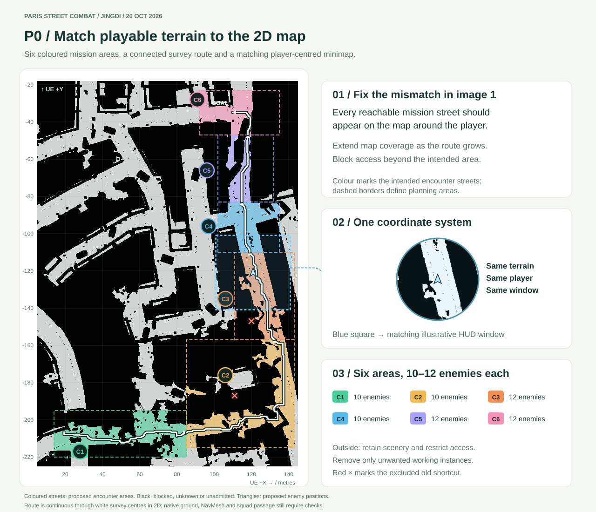
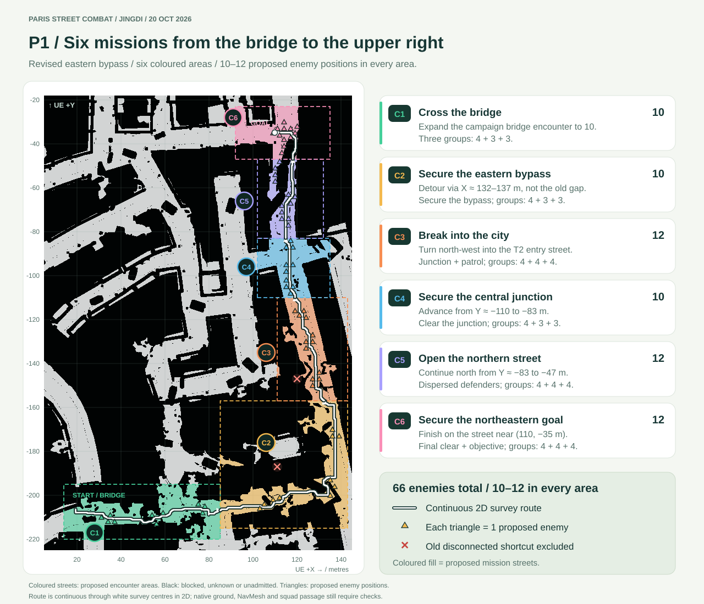

# Development adjustment suggestions — Jingdi, 20 October 2026

**Priorities:** P0 — gameplay foundations; P1 — next development goals; P2 — optional balance improvements.

## P0 — Align playable terrain and the 2D map

- Define a connected playable corridor covering all six campaign missions, and display its terrain accurately on the full map and minimap.
- Use consistent coordinates, scale and orientation for terrain, player position, allies and objectives.
- Restrict access to areas outside the mapped mission corridor. Remove unnecessary out-of-range instances from the working level where appropriate, while preserving original assets and useful inaccessible scenery.
- Check terrain support, collision and navigation before removing geometry or finalizing boundaries. Expand map coverage as new mission areas are added.

*Map the intended streets in all six coloured areas and restrict access outside the mission corridor. The blue window and minimap use matching terrain coordinates. Dashed borders show proposed encounter areas.*

## P0 — Design NPC behavior trees and motions

- Give enemies distinct **guard**, **foot patrol** and **local support/reposition** roles, distributed across cover and junctions.
- Use a shared Behavior Tree with separate perception, target memory and decision state for each NPC.
- Let enemies engage visible targets, search reachable points around the last observed position for a limited time, then return to their assigned role.
- Let allies follow, regroup and occupy distinct support positions. Add waiting, yielding and bounded replanning at narrow passages.
- Integrate idle, walk, run, turn, stop, aim, fire, reload, hit and death motions with actual movement and combat state. Reuse compatible existing assets and preserve weapon grips.
- Keep reload ammunition transfers and death events single-use. Add advanced actions such as NPC grenade throwing or cover leaning only after their movement and animation requirements are ready.

## P1 — Separate Tutorial and Campaign selections

- Provide **Tutorial**, **New Campaign**, **Continue Campaign**, **Settings** and **Exit** in the main menu, with mouse and keyboard selection.
- Keep basic movement, controls, equipment, medicine and checkpoint lessons in Tutorial.
- Start Campaign directly with the bridge mission briefing and objective, without mandatory control lessons or practice counters.
- Offer replay, return to menu or an explicit campaign start after Tutorial completion.
- Keep tutorial and campaign progress separate. Replaying Tutorial must preserve campaign saves, casualties and inventory.

## P1 — Increase M1 Garand ammunition

- Use an **eight-round clip** and start new sessions with **8 loaded rounds + 120 reserve rounds**.
- Provide finite ammunition supplies along the campaign route; use **160 reserve rounds** as an initial proposed carrying cap.
- Update loadout, supply limits, reload lessons, HUD and save rules consistently. Display three-digit reserve counts clearly.
- Preserve ammunition during interrupted reloads. Carry actual ammunition between missions; checkpoint loading restores saved counts, while a full new-campaign restart restores the initial loadout.

## P1 — Build a six-stage campaign toward the upper right

Use the bridge location as C1 and expand its campaign encounter to **10 enemies**. Give **every mission area 10–12 distinct enemies**, including C1, with a different movement or combat decision in each area.

**Revised route:** lower-left bridge → far-eastern bypass → city entry near T2 → central junction → northern street → northeastern street objective. The C2–C3 connection follows the outer road near **X ≈ 132–137 m**, then turns north-west near **(132, −157 m)**; exclude the old shortcut through the disconnected patch.

*Each colour marks one mission area; each triangle marks one proposed enemy. The white route follows continuous white survey cells around the old disconnected shortcut, marked with red crosses. This is 2D candidate connectivity; actual ground, navigation and squad passage still need checking.*

Coordinates below are approximate planning locations in metres, with right = +X and up = +Y. Confirm actual walkability and connections before final placement.

| Mission | Proposed route / area | Main objective and tactical choice | Enemies |
| --- | --- | --- | --- |
| **C1 — Cross the bridge** | Lower-left bridge and bridgehead, ending near **(85, −207)** | Expand the campaign bridge defence, defeat its groups and secure the crossing. | **10**, grouped **4 + 3 + 3** |
| **C2 — Secure the eastern bypass** | From the bridgehead around the far-eastern road at **X ≈ 132–137**, reaching **(132, −157)** | Clear the bypass and secure a regroup/supply point; choose covered movement or smoke. | **10**, grouped **4 + 3 + 3** |
| **C3 — Break into the city** | Turn north-west from **(132, −157)** into the entry street near T2, then toward **(119, −110)** | Break the entry defence and patrol while allies hold separate support positions. | **12**, grouped **4 + 4 + 4** |
| **C4 — Secure the central junction** | Continue from **Y ≈ −110 to −83**, around **X ≈ 115–120** | Cross exposed street connections, handle enemy search and secure the junction. | **10**, grouped **4 + 3 + 3** |
| **C5 — Open the northern street** | Advance north from **Y ≈ −83 to −47**, around **X ≈ 115–119** | Clear dispersed street defenders using corner checks and distinct support positions. | **12**, grouped **4 + 4 + 4** |
| **C6 — Secure the northeastern goal** | Follow the upper street to approximately **(110, −35)** | Clear the final groups and reach the northeastern street objective to complete the campaign. | **12**, grouped **4 + 4 + 4** |

- Use finite, spatially separated groups: **66 enemies across six areas**, with **10–12 in every area**. Avoid infinite waves and replacement of defeated enemies.
- Begin encounter pacing with roughly 3–4 engaged enemies, allowing nearby groups to respond naturally. Increase overlapping contacts according to navigation, responsiveness and performance.
- Resolve route gaps before connecting missions; select a different connected corridor where necessary.
- Define each mission's objectives, complete enemy roster, patrol/search areas, supplies and checkpoint. Mark C1–C5 as stage completion and reserve campaign victory for C6.
- Unlock checkpoints through elimination of the assigned registered enemy group; retain circle entry and explicit save interaction. Preserve health, ammunition, used supplies and casualties between stages. Saving must not heal, refill or revive.
- Extend campaign saves to support stable actor identities and larger mission rosters while preserving existing saves.

## P2 — Add limited breath/rest healing

- Add slow recovery while a living player rests without taking damage, alongside the medical-kit system.
- Start with a proposed **eight-second damage-free delay**, followed by **4 HP/second**, capped at **60/100 HP**.
- Reset the delay when damaged; suspend recovery during movement, firing, reloading or other actions, and during pause, menus or loading.
- Keep medical kits useful for faster healing and recovery beyond 60 HP. Prevent simultaneous automatic and medical-kit healing.
- Show a short recovery indicator and suitable breathing feedback. Preserve actual health on save/load without granting healing for time spent outside gameplay.
